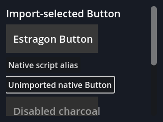
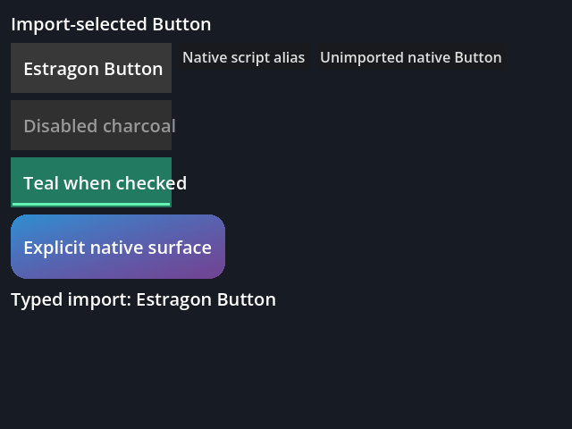

# D07 — import-selected Button and charcoal defaults

Issue [#146](https://github.com/papercraftgames/Estragon/issues/146), base owner-merged
S04 `382b88229eb395a78e8ee8fbe7105a7953092482`. Native product implementation is
`cc273dc`; paired acceptance source is `7a6bad19a68f3f20a20b82a45e1bc5e9f195cc5c`.
Final4.7 editor-only verification is `bbbee217352c4740d82d9f53b9891543960fb189`;
its only change is the exact expected authored-diagnostic matcher. Production and
native fixture bytes are identical between those two acceptance heads.

[Verified phase summary](../../tests/button_imports/evidence/verified-summary.json),
[source qualification](../../tests/button_imports/evidence/source-qualification.json)
and [artifact hashes](../../tests/button_imports/evidence/artifact-hashes.json)
retain the exact commands, engines, source/map/UID hashes, original failures and
PASS results. This is development package acceptance, not release certification.

| Actual Linux engine | Frontend / runtime | Native editor / cold restart | Installed bytes, maps and UIDs |
| --- | --- | --- | --- |
| Official4.0.4 `fc0b241c9` |26 /29 PASS |41 /13 PASS |155 files,72 addon UIDs unchanged;4 authored source/map/UID identities audited |
| Pinned4.7.0 `5b4e0cb0f` |26 /29 PASS |41 /13 PASS |Same155 file hashes and72 addon UIDs unchanged; same4 source/map/UID audits |

The paired run uses one Yarn development tarball on both engines:
`b6bc59e6844e0533a6ef5f0219f0b50564f25bc45281a2d25782c755e03ced47`.
The final4.7 editor-only phase uses
`0050a1a82591667bd5577ee5976c508f88b0478db82825396801935ab11d58fb`.
Yarn staging timestamps change the archive headers across separate packs;
**all155 payload file hashes match exactly**. Each staged pack reproduced its
own tar twice. Neither artifact is a tagged release, certified publication or
permission to publish. Each consumer uses actual Yarn installation under
`node_modules/@papercraftgames/estragon`, with the complete installed plugin.cfg
path enabled, no package copy/symlink/ignore, and post-editor byte checks.

## Native behavior proved

Both engines first rejected raw GDScript `const Button=preload(...)` with
`The member "Button" shadows a native class`, status43. The original
[4.0 probe](../../tests/button_imports/evidence/attempts/probe40.log) and
[4.7 probe](../../tests/button_imports/evidence/attempts/probe47.log) precede
implementation. Gogo's lexical token-span lowering produces legal private names
and exact authored mappings, preserving strings, Unicode, comments and unrelated
members. Constructors, ordinary Script aliases, typed/bindable references,
imported Gogo property metadata and GGX descriptors share the selected identity.

Actual imported Button is Node2D; an unimported Button remains native Control.
An ordinary authored native Script (`extends Button` in its own source) provides
the explicit mixed-file NativeButton alias. ClassDB construction stays native.
Old explicitly imported user UiButton still mounts/clicks unchanged. Missing,
duplicate, Resource/non-Node, required-constructor and invalid-property imports
reject at source spans. Each actual Play path rejects missing/duplicate/Resource
and typed-return errors, preserves code/map/UID/timestamp/cache, then saves the
repaired buffer and runs a real rendered game.

Real CodeEdit offers distinct origins. Deliberate Estragon selection inserts the
Button preload and tag in one undo/redo; native selection adds no import. Pure
completion checks cover Add Missing Imports, fields after import removal and
actual definition paths. No prefixed catalog recommendation or global Button
registration exists.

Properties/cache and real pixels prove exact normal383838/hover505050/
pressed252525/disabled303030 before custom writes, re-enable and draw-only state
changes. Checked Toggle stays teal with its underline; disabled wins. Native
and custom events fire once, retained identity/subscriptions clean up, spread
omission restores charcoal, padding14/8 and square defaults remain. Actual
Inspector edits/undo/redo/save/reload, both Play games and restart are native.
Godot4.0 text scenes round Color floats; reload uses `is_equal_approx`, separately
from exact fresh-instance defaults and pixel checks. No production workaround.

Captures were inspected at320×240,640×480 and1000×800, including hover/disabled,
checked Toggle, native Controls, scroll/Wrap and explicit S04 gradient/radii:




## Commands and scoped regressions

Retained tooling: `bun install --frozen-lockfile`; `bun run check` (TypeScript and
30 policy tests PASS). Existing policy tests retain their historical packaging
subprocesses; the new acceptance collector and regression adapter use Yarn.
No new Python/npm/npx tooling or workflow/release/version changes were added.

From `/repo` in the existing Linux container, with Xvfb/Openbox and isolated
engine settings supplied by the harness:

```sh
COREPACK_ENABLE_PROJECT_SPEC=0 corepack yarn@1.22.22 node --experimental-strip-types tools/check-button-imports.ts --editor --engine 4.0.4=/evidence/s03-engines/godot-verified-4.0.4/Godot_v4.0.4-stable_linux.x86_64 --engine 4.7=/evidence/s03-engines/godot-verified-4.7/Godot_v4.7-stable_linux.x86_64 --output /tmp/d07-final-pair5
COREPACK_ENABLE_PROJECT_SPEC=0 corepack yarn@1.22.22 node --experimental-strip-types tools/check-button-imports.ts --editor-only --engine 4.7=/evidence/s03-engines/godot-verified-4.7/Godot_v4.7-stable_linux.x86_64 --output /tmp/d07-final-editor6
```

The paired command's original4.7 collector FAIL remains in its raw results:
all41 native assertions passed, but the matcher rejected the expected authored
`49:1` typed-return error. The runner-only fix and final editor/restart PASS are
[separate evidence](../../tests/button_imports/evidence/editor-final/4.7/results.json),
not a rewritten original report. Earlier tar-directory/stale-variable/fixture-path
failures and the4.0 exact float assertion are retained in `attempts/`.

Eight scoped4.7 regressions PASS, with individual commands/results/provenance in
[regressions](../../tests/button_imports/evidence/regressions):

| Check | Result |
| --- | --- |
| GGX native compiler/editor | Runtime55, real editor89, build/import PASS |
| Counter (`check-native-ui.ts --runtime-only`) | Runtime32/build PASS |
| Native Controls |57, Exit quit, example build/runtime PASS |
| S01/S02 styling |158, negative validation PASS |
| S04 surfaces |43, negatives32, default pixels, real rendered Play PASS |
| UX01/U02 | Syntax/math/maxima/clip/native+nested scroll/rejections/gallery/inherited/removal PASS |
| Responsive Grid/Wrap | Frontend21, math95, runtime44, graphics PASS |
| S03 spreads |28 PASS after updating obsolete purple expectation; original FAIL retained |

GGX and Counter use their existing isolated copy-based regression harnesses;
they are not claimed as installed-package proof. The other six existing scoped
harnesses run through the preserved TypeScript adapter, which substitutes only
Yarn development packing for their npm-based pack import. Their native tests
and stage selection are unchanged. The adapter and exact invocations are stored
as `yarn-regression-runner.ts.txt`; the corrected spread rerun is recorded
separately. This does not alter release packaging tools.

Current S04 baseline was deliberately re-captured, preserving historical S04
images and provenance. Compared with historical pixels, only the two unstyled
Button/Toggle rectangles change:22806 pixels on4.0.4,22818 on4.7, zero outside
x16..195 / y276..340 and364..428. The scoped S04 check enforces that boundary
and byte identity against the new charcoal baseline.288 canonical script UIDs
are paired/unique; generated source maps match their migrated authored source.

Manual interactive visual smoke did **not** run. Automated native editor/game
rendering/input did. Other minors/platforms, physical keyboard tests, exhaustive
73-stage/release certification and publication were not run. Routine required CI
is independent verification after the review-ready push; its URL/result and
execution wall time belong in the live issue/PR handoff. No auto-merge.
