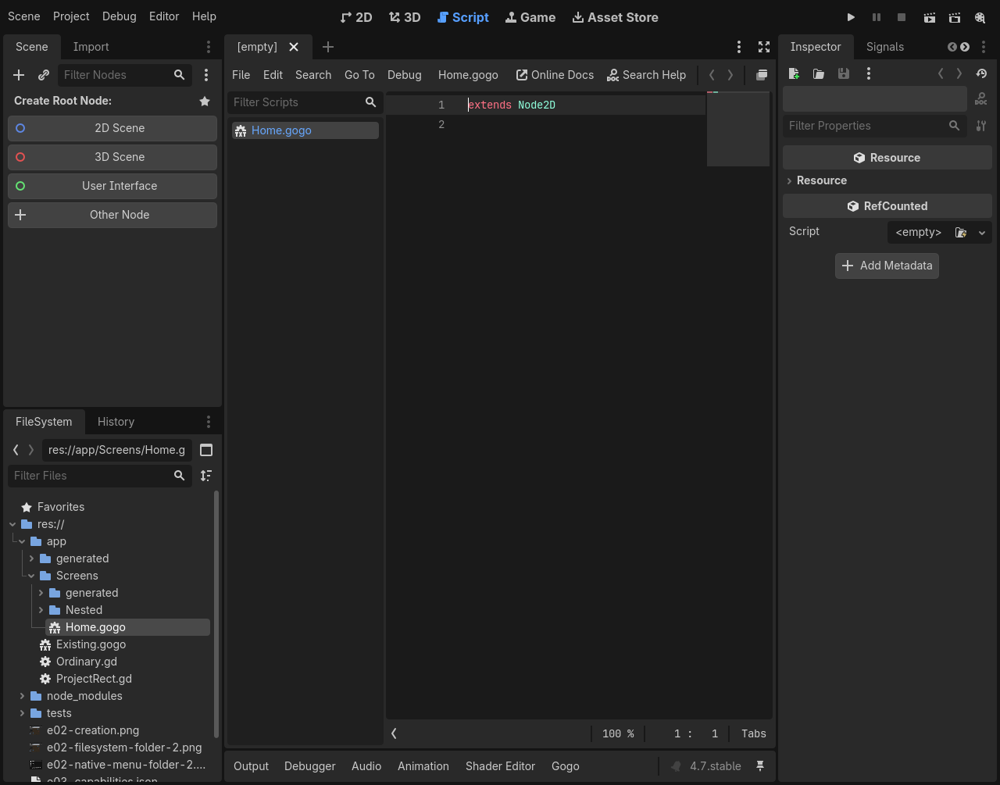
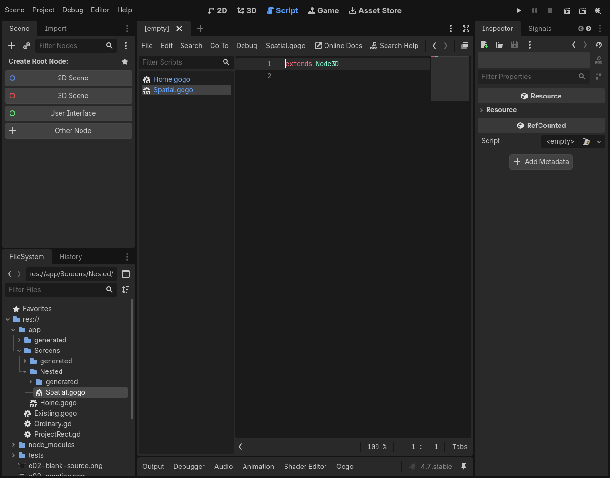
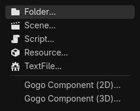

# E04 follow-up #132 — initial bare-host defaults (archival)

**Superseded during owner review of PR #133:** the owner requested a typed build_view starter returning a plain native grouping node. See [current starter-stub evidence](E04_STARTER_STUBS.md). This report preserves the earlier bare-extends revision and its actual results.

Issue [#132](https://github.com/papercraftgames/Estragon/issues/132); native-tested clean source `8d239eb7016d69be5881cec3be3bafa7eecb2636`, base `bb96534179cf151a619490fed9cb707a16b79b5c` (merged E04 #131). Subsequent edits record documentation/evidence only. Implementation awaits owner review/merge.

New components contain exactly `extends Node2D\n` or `extends Node3D\n`. There are no imports, build_view, names, widgets, Entry scope, sizes, viewport scales or greeting. A null root view is currently invalid: `composition/computation.gd::_flush` requires an Element after normalization; null is supported only for child slots. Omitting build_view provides a valid native component without inventing empty-root semantics. An author may later add a normal typed view returning an ordinary child description or deliberately establish an Entry scope.

The owner additionally requested separate **Gogo Component (2D)…** and **Gogo Component (3D)…** actions during this session. Both FileSystem actions and the 4.0.4 Tools fallback use the same dialog/template service and preselect the requested type; the chooser remains editable. No compiler/runtime, existing authored/generated application file, supplied Asset, E05 attachment feature, workflow or release change.

## Focused local acceptance

| Official Linux engine | Editor assertions / wall | Restart assertions / wall | Template/import probes |
| --- | --- | --- | --- |
| 4.0.4 (`fc0b241c9`) | 94 PASS / 22.89s | 6 PASS / 10.00s | 33 PASS each, direct / relocated / standard |
| pinned 4.7.0 (`5b4e0cb0f`) | 143 PASS / 25.95s | 15 PASS / 9.34s | 33 PASS each, direct / relocated / standard |

All stages PASS with zero unexpected errors. Complete local two-engine wall time: **83.65s**, independent of routine CI's 60-second budget. `bun install --frozen-lockfile` and `bun run check`: typecheck + **30 policies PASS**. `git diff --check origin/main`: clean.

The headless fixtures compile/load exact blank 2D/3D sources and add native instances to the tree, checking zero children and no build_view. They then author child views returning ordinary native Nodes without an Entry and verify actual mounting. Existing destination-aware import probes remain, including paths with spaces.

The real isolated editor creates blank 2D and nested 3D sources through both dimension-specific FileSystem actions on 4.7; Tools fallback selects both types on 4.0.4. Exact source bytes, immediate highlighting/completion/diagnostics, native build/type metadata and unchanged project/config during creation pass. Root/empty-space menus, cancel, duplicate/extension/excluded/traversal rejection and normal `.gd` services remain passing. FileSystem lifecycle checks count **two** owned actions, **zero** after disable, then **two** after re-enable/restart. Built-in Script/TextFile actions remain present.

Blank main/current Play runs both exact generated host scripts. A separate native observer is a sibling outside the component, verifies zero component children and absence of build_view, and records proof only after frames settle; neither blank source is instrumented or rewritten for Play. The fixture then deliberately authors imports/root UI, compiles, attaches and verifies normal main/current rendering and restart. The later test greeting is authored test content, not a template default. Native source/menu, blank runtime and later rendered captures were inspected on both engines.








## Reproduction and provenance

Used the existing owner-approved local Docker/Xvfb/Openbox environment from [E04](E04_CREATION.md#exact-local-execution-and-provenance): read-only repository `/repo`, authenticated engine cache `/engines`, writable host `/tmp/e04-local` at `/evidence`, software OpenGL/Vulkan, self-contained isolated editor settings and empty product compiler-tool PATH. The container was restarted with `docker start estragon-e04-local`; its previous Openbox install remained available. No user checkout plugin/settings were enabled or changed.

```sh
bun install --frozen-lockfile
bun run check
/usr/bin/time -p docker exec -w /tmp \
  -e XDG_RUNTIME_DIR=/tmp/e04-runtime estragon-e04-local \
  xvfb-run -a sh -c 'openbox > /tmp/132-openbox.log 2>&1 & exec corepack yarn@1.22.22 node --experimental-strip-types /repo/tools/check-editor-ux.ts --creation --engine 4.0.4=/engines/godot-verified-4.0.4/Godot_v4.0.4-stable_linux.x86_64 --engine 4.7=/engines/godot-verified-4.7/Godot_v4.7-stable_linux.x86_64 --output /evidence/132-acceptance'
```

The runner authenticates official engine identity and bytes against `tests/compatibility/linux-engines.json` before launch. Binary SHA-256: 4.0.4 `e9a0db9798cf53385693898af39f98d0065552c0808b9e7eb82cfcb0da880ae9`; pinned 4.7.0 `f85bbc6b15e22416c7d797cd60b63286dd67b9cb13498847056c18520ae55a75`.

Both tested identical reproducible development tar SHA-256 `c62cbd02a62703da7be10abd699a875fb640cb79132cdff2972b6296f381dc22`, installed directly with Yarn. All installed bytes and **48 addon UIDs** remained unchanged. The new native test observer has its own stable Godot-generated UID; existing UIDs remain untouched. No copy/symlink/package-ignore fallback. Each engine's [4.0.4](132/4.0.4/results.json) / [4.7](132/4.7/results.json) record preserves exact stage commands/statuses/timing; adjacent native logs have only trailing whitespace normalized. Full local artifacts: `/tmp/e04-local/132-acceptance`.

## Limits and development checkpoint

Godot 4.0.4 has the two Tools actions, with no native FileSystem hook claimed. Manual interactive/macOS smoke, the full editor/73-stage regression battery, release certification and registry/publication consumers were not run. This remains focused native acceptance, not release evidence. Routine/publication workflows were not changed or dispatched during development.

The first local 4.7 attempt passed blank Play and authored-view compilation but its temporary instrumentation rewrote the same scene source, causing a native external-change confirmation that blocked subsequent menu input. That run is retained as FAIL under `/tmp/e04-local/132-dev47`. The final fixture uses the sibling observer with untouched blank component scripts; no production workaround or new error allowance. A subsequent 4.7 development run and the final two-engine run pass. Historical E04 demo-template evidence remains archival and unmodified.
