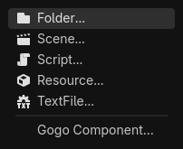
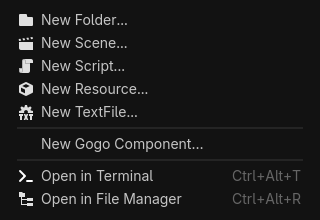

# E04 — native Gogo component creation evidence

Issue [#124](https://github.com/papercraftgames/Estragon/issues/124). Native-tested source: `32b10a4b2fd166423367338a00b35e5f81f377d9`, clean checkout; base `5ae8908e28e47c29b23dc2134196843d880cdd0c`. Subsequent changes only record documentation/evidence. Review-ready implementation; not Done until owner review and merge.

## Observed acceptance

| Approved official Linux engine | Editor assertions / wall | Restart assertions / wall | Template/import assertions |
| --- | --- | --- | --- |
| 4.0.4 (`fc0b241c9`) | 82 PASS / 19.27s | 6 PASS / 9.33s | 25 PASS in each direct, relocated and standard layout |
| pinned 4.7.0 (`5b4e0cb0f`) | 119 PASS / 21.82s | 14 PASS / 8.91s | 25 PASS in each direct, relocated and standard layout |

Both engine records have zero unexpected errors. Complete local run: **73.38s** including installation, native editor/game/restart and bounded template probes; this is separate from routine CI's 60-second budget. Frozen install and `bun run check` passed typechecking and all 30 policy tests locally.

On 4.7, real right-button input on the exact `res://app/Screens/` Tree item opens Godot's Create New submenu. A native mouse selection of Gogo Component creates extensionless-name `Home` as `Home.gogo` there. The source opens with Gogo highlighting, completion and diagnostics; immediate build and native generated metadata checks pass. Root-folder and genuinely empty-space menus start at `res://`. Tests count one owned action, zero after disable, one after re-enable and one after restart. Built-in Script/TextFile actions remain present, and ordinary `.gd` retains its native services.

On 4.0.4, the plugin loads without parsing the newer native class. Project > Tools > New Gogo Component uses the selected directory and the public FileDialog fallback. No FileSystem context-menu support is claimed on that engine.

Both prove cancellation, existing-source preservation (including 4.0's overwrite warning), excluded-root and wrong-extension rejection without silently creating `Bad.txt.gogo`, lexical traversal/invalid path rejection, nested 3D creation, unchanged project/config bytes during creation and working relative imports. Headless probes instantiate both templates at actual generated paths. A matching Node2D scene host runs the authored greeting through both main/current Play, including after editor restart. The native 3D template receives compiler/load sanity only.






The menu PNGs come from the actual separate native PopupMenu viewports; main-editor viewport captures alone omit those windows. These captures, final editor syntax/gutter captures and both engines' rendered greetings were inspected.

## Exact local execution and provenance

The owner approved Docker for local Linux verification in this session, superseding the issue's initial no-Docker constraint. Existing Debian bookworm image `estragon-p02-linux-env:local` (`sha256:134d5d38b4de84e53d87f4b42c40e5e51bac4ba5c57fdd2a52e795a0e61e30eb`) supplied Node 24.22.2, npm 11.13.0, Yarn 1.22.22, Xvfb `21.1.7-3+deb12u13` and Mesa llvmpipe `22.3.6-1+deb12u2`. Openbox `3.6.1-10` was installed into the disposable container with `apt-get update -qq && apt-get install -y --no-install-recommends openbox` to provide normal window focus behavior. No contributor/product dependency or workflow was changed.

Repository was mounted read-only at `/repo`; existing authenticated engines read-only at `/engines`; host `/tmp/e04-local` at `/evidence`. Container environment: `LIBGL_ALWAYS_SOFTWARE=1`, `VK_ICD_FILENAMES=/usr/share/vulkan/icd.d/lvp_icd.x86_64.json`. Git safe.directory was set only in the container. A mode-700 `/tmp/e04-runtime` supplied XDG_RUNTIME_DIR. The runner creates self-contained engine copies, isolated editor settings and an empty compiler-tool PATH; the user checkout's plugin/preferences were never enabled or changed.

```sh
bun install --frozen-lockfile
bun run check
/usr/bin/time -p docker exec -w /tmp \
  -e XDG_RUNTIME_DIR=/tmp/e04-runtime estragon-e04-local \
  xvfb-run -a sh -c 'openbox > /tmp/e04-openbox.log 2>&1 & exec corepack yarn@1.22.22 node --experimental-strip-types /repo/tools/check-editor-ux.ts --creation --engine 4.0.4=/engines/godot-verified-4.0.4/Godot_v4.0.4-stable_linux.x86_64 --engine 4.7=/engines/godot-verified-4.7/Godot_v4.7-stable_linux.x86_64 --output /evidence/acceptance-ready'
```

Engine SHA-256 values, authenticated against the repository manifest before launch:

- 4.0.4: `e9a0db9798cf53385693898af39f98d0065552c0808b9e7eb82cfcb0da880ae9`.
- 4.7.0: `f85bbc6b15e22416c7d797cd60b63286dd67b9cb13498847056c18520ae55a75`.

Both tested identical reproducible development tar SHA-256 `6c1c6d16326d3c5fb31349aff3f4ea2812fa692b13861ea4173fd804aacd211a`, installed directly with Yarn. Installed package bytes and all 48 canonical UIDs remained unchanged. No copy, symlink or package `.gdignore` workaround. Relocated/standard runs only exercise template/import paths; they are not extra editor suites. Each engine's [4.0.4](e04/4.0.4/results.json) / [4.7](e04/4.7/results.json) record retains exact stage arguments, statuses and durations, alongside provenance, consumer audit and native logs (trailing whitespace normalized). Full local artifacts remain under `/tmp/e04-local/acceptance-ready`.

## Limits and development failures

This is E04-focused native acceptance, not release certification, native analyzer parity, all-platform support or a full editor regression PASS. Manual interactive/macOS smoke, the opt-in full 73-stage battery and publishing/registry consumers were not run. No physical keyboard gate is required.

Earlier local development runs retained failures under `/tmp/e04-local`: initial popup input bypassed native window routing; zero-relative/velocity mouse events were ignored; idle main-viewport capture waited indefinitely; and unverified row coordinates hit the wrong item after Play resized the FileSystem dock. Fixtures now use native window input, actual hover feedback, forced evidence frames and exact Tree hit testing. A non-tool editor `can_instantiate` assertion was corrected to metadata inspection; actual instantiation remains checked headlessly and in child games.

Earlier broad default-profile attempts also hit bare-Xvfb BadWindow and deliberate unsavable-file-as-directory scan/focus races on 4.0.4. They are not reported as passing full regression. The original full profile remains intact. The E04 `--creation` profile keeps relevant editing, rendered Play, lifecycle and package checks, while skipping those unrelated destructive-buffer scenarios and the owner-closed #123 probe. No errors were newly allowlisted and no production compiler/build/cache behavior was changed.
