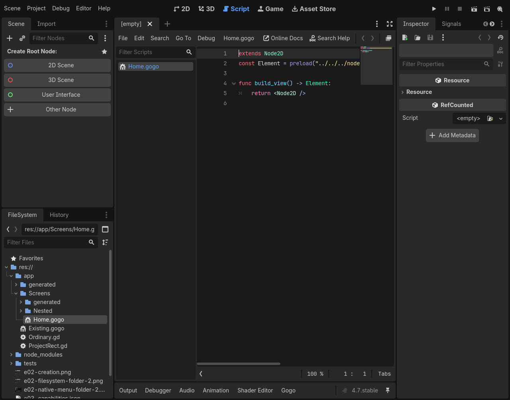
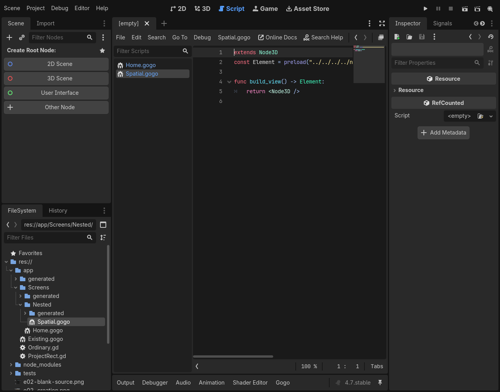

# E04 #132 / PR #133 — minimal native view stubs

Owner review explicitly requested a `build_view() -> Element` starter. Current native-tested clean source: `4572f6c619ad428426b377a16933e3c149d07a60`, base `bb96534179cf151a619490fed9cb707a16b79b5c`; later changes only record documentation/evidence. Same review PR #133, no replacement PR. Earlier [bare-host evidence](E04_BLANK_DEFAULTS.md) is archived, not current-stub proof.

Both templates extend the chosen native host, preload only Element using the actual generated-directory/install-relative path, and return one unconfigured ordinary native grouping node:

```gogo
func build_view() -> Element:
	return <Node2D />
```

The 3D variant returns `<Node3D />`. These native grouping nodes draw nothing and establish no Estragon layout scope. There is no Entry, text, artificial name, size or viewport scale. `Entry` in the former demo was an explicit import alias for Estragon's layout entry, not a language keyword. An app may deliberately use the 2D/3D entry when it needs layout; a generic component does not choose that by default. Null remains a child-slot value, not a supported composition root. No compiler/runtime semantics changed.

Separate 2D/3D FileSystem and Tools actions, the shared editable chooser, validation, destination selection and source navigation remain unchanged from the prior reviewed branch revision.

## Local acceptance

| Official Linux engine | Editor / wall | Restart / wall | Template/import probes |
| --- | --- | --- | --- |
| 4.0.4 (`fc0b241c9`) | 94 PASS / 23.39s | 6 PASS / 10.73s | 33 PASS each, direct / relocated / standard |
| pinned 4.7.0 (`5b4e0cb0f`) | 143 PASS / 26.86s | 15 PASS / 9.22s | 33 PASS each, direct / relocated / standard |

All stages PASS, zero unexpected errors; complete local wall **84.32s**. `bun run check`: typecheck + **30 policies PASS**, `/tmp/132-stub-static.log`. Frozen dependencies were already verified with `bun install --frozen-lockfile` for this unchanged-tooling task. `git diff --check` is clean.

Headless probes check the minimal source shape/one needed import, compile/load it at its actual path and mount exactly one native leaf of the matching class, without a script or children. They then author nested native children without an Entry scope and verify mounting. Native editor/main/current Play runs both exact starter scripts; the sibling observer checks the same leaf invariant without modifying either component. The source opens with Gogo services, both dimension actions/preselection and root/nested/empty contexts work, overwrite/cancel/extension/source-root safeguards remain, ordinary .gd stays native, and disable/re-enable/restart preserve exactly two owned actions (zero while disabled). Later explicitly authored root UI still compiles/renders. The later greeting remains test-authored content, not generated template content.

Native source, plain game and later authored rendering captures were inspected on both engines. The editor image below shows the actual generated preload and typed stub; the game viewport has no default rendered content.






## Reproduction and immutable evidence

Same owner-approved Docker/Xvfb/Openbox environment and read-only repository/engine mounts as the [initial #132 run](E04_BLANK_DEFAULTS.md#reproduction-and-provenance). Self-contained engine copies isolate editor settings and product compiler PATH; no user checkout plugin or preferences changed.

```sh
bun run check
/usr/bin/time -p docker exec -w /tmp \
  -e XDG_RUNTIME_DIR=/tmp/e04-runtime estragon-e04-local \
  xvfb-run -a sh -c 'openbox > /tmp/132-stub-openbox.log 2>&1 & exec corepack yarn@1.22.22 node --experimental-strip-types /repo/tools/check-editor-ux.ts --creation --engine 4.0.4=/engines/godot-verified-4.0.4/Godot_v4.0.4-stable_linux.x86_64 --engine 4.7=/engines/godot-verified-4.7/Godot_v4.7-stable_linux.x86_64 --output /evidence/132-stub-acceptance'
```

Both tested identical reproducible development tar SHA-256 `d71e44b8b921477fc58257e71785eaf66266865739c4bf997f3785292ee1cfc8`; installed bytes and all 48 addon UIDs unchanged during editor acceptance. Binary SHA-256: official 4.0.4 `e9a0db9798cf53385693898af39f98d0065552c0808b9e7eb82cfcb0da880ae9`; pinned 4.7.0 `f85bbc6b15e22416c7d797cd60b63286dd67b9cb13498847056c18520ae55a75`. The runner authenticates both before launch.

Exact stage commands/statuses/timings and provenance: [4.0.4](132-stub/4.0.4/results.json), [4.7](132-stub/4.7/results.json). Adjacent logs preserve native output with trailing whitespace normalized only. Complete local artifacts: `/tmp/e04-local/132-stub-acceptance`. No failed current-stub acceptance stages. Prior bare-host development failures remain documented in the historical report.

Godot 4.0.4 retains Tools fallback only. Manual interactive/macOS smoke, full editor/73-stage regression and release/registry certification were not run. This is focused native acceptance, not release evidence. No existing authored/generated application file, supplied Asset, UID, runtime/compiler, workflow/version/tag/release/publication or E05 attachment change. One owner-requested coherent follow-up push to the existing PR after local validation; owner reviews/merges.
