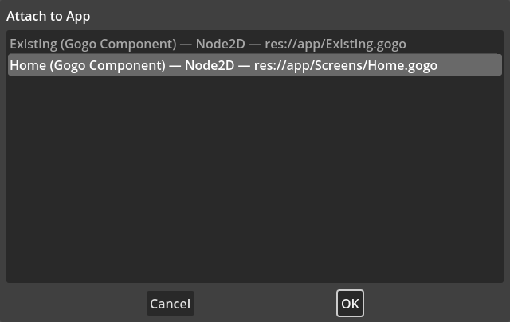
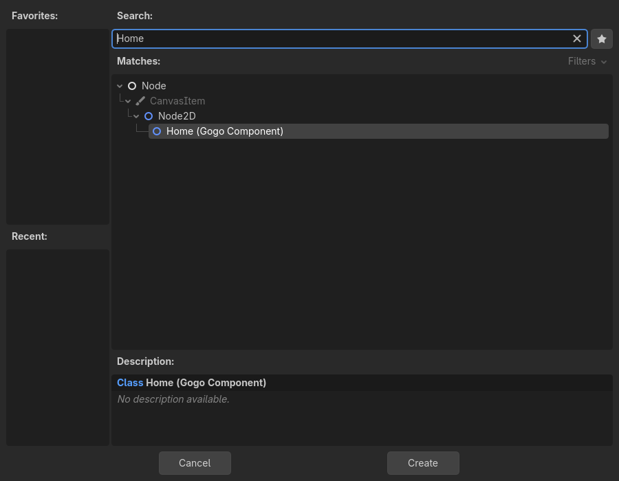
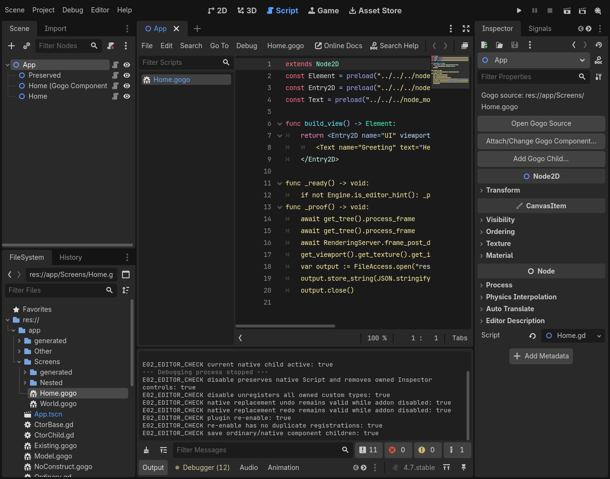

# E05 #128 — native Gogo scene components

Issue [#128](https://github.com/papercraftgames/Estragon/issues/128). Native-tested clean source: `3643d9e7665e66a42d1df1e400f3a9c59e63be72`; base merged main `e1befb1c91c2fbfdf7e508c1b90fa668bf753900` (#133). Later edits record evidence/status only. Review-ready implementation; owner review/merge remains outstanding.

The Inspector attaches/changes authored Gogo sources, opens their original source and adds native children. Public custom-type registration supplies stock Create New Node discovery on both tested engines. Native Script references plus the existing compiler maps retain the authored association; scene ownership, ordinary children, Script properties and UndoRedo remain native. No user-Node metadata, helper Nodes, authored construction during listing, compiler/runtime fork or private editor injection. Production changes are editor-only; compiler/runtime, templates, supplied Assets and release workflows are unchanged.

## Focused local acceptance

| Official Linux engine | Editor assertions / wall | Restart assertions / wall | Template/import probes |
| --- | --- | --- | --- |
| 4.0.4 (`fc0b241c9`) | 106 PASS / 34.27s | 5 PASS / 9.95s | 33 PASS each, direct / relocated / standard |
| pinned 4.7.0 (`5b4e0cb0f`) | 114 PASS / 30.84s | 5 PASS / 8.27s | 33 PASS each, direct / relocated / standard |

All focused stages PASS, zero unexpected native errors. Complete two-engine focused wall: **97.42s**, separate from routine CI's 60-second budget. Typecheck and all **30 policy tests PASS**; frozen install succeeds. Exact [4.0.4](e05/4.0.4/results.json) / [4.7](e05/4.7/results.json) commands/statuses/timings, adjacent native logs, provenance and package manifests are committed. Log copies normalize trailing whitespace only.

Both engines installed the identical reproducible development tar SHA-256 `e82fa9cfdcc856cdc6bb7f14322267abc3ed8d1a3674cee0970d22ad0facca05` directly with Yarn under `res://node_modules/@papercraftgames/estragon/`. Installed bytes and all **50 addon UIDs** remained unchanged. No copy/symlink/package-ignore fallback. Standard/relocated paths receive bounded existing compile/load probes, including spaces, without another editor battery.

The native workflow creates Home.gogo through the existing creation surface (4.7 FileSystem / 4.0.4 Tools), deliberately authors a rendered test view, attaches via the visible Inspector/source picker, opens original source, saves and executes main/current scenes. It searches/selects/inserts Home through stock Create New Node, adds an Inspector child, and verifies source association and owner after save/restart. The greeting/Entry in captures is explicitly authored test content; E04's minimal templates are unchanged.

Native scene Undo/Redo, null/ordinary/Gogo replacement and exported-value restoration, cancellation, incompatible 2D/3D host rejection, 3D child creation, source-qualified duplicate search, model/required-constructor exclusion, valid effective constructor overrides, move/delete/new source updates, missing-output regeneration, actual missing-source Play rejection, invalid unsaved source rollback/recovery, dirty-buffer registration suspension, disable/re-enable and pending native Undo/Redo while disabled all pass. Both Play paths run with isolated native autosave disabled, proving the existing Gogo forced-save gate; explicit native scene saves are separately exercised. Failed Play retains output bytes/maps/timestamps/UIDs and cached Script identity. The synchronous scene rejection is captured before a later source-only background build can replace last_report.








## Reproduction and provenance

Used the owner-approved existing Docker/Xvfb/Openbox environment: container `estragon-e04-local`, image `estragon-p02-linux-env:local`, read-only repository `/repo`, authenticated read-only engines `/engines`, host `/tmp/e04-local` mounted at `/evidence`. Software OpenGL/Vulkan, isolated self-contained editor settings and an empty product compiler-tool PATH. No plugin or preference was enabled/changed in the shared checkout.

```sh
bun install --frozen-lockfile
bun run check
/usr/bin/time -p docker exec -w /tmp \
  -e XDG_RUNTIME_DIR=/tmp/e04-runtime estragon-e04-local \
  xvfb-run -a sh -c 'openbox > /tmp/e05-openbox.log 2>&1 & exec corepack yarn@1.22.22 node --experimental-strip-types /repo/tools/check-editor-ux.ts --scenes --engine 4.7=/engines/godot-verified-4.7/Godot_v4.7-stable_linux.x86_64 --engine 4.0.4=/engines/godot-verified-4.0.4/Godot_v4.0.4-stable_linux.x86_64 --output /evidence/e05-ready'
```

Official binary authentication uses `tests/compatibility/linux-engines.json` before launch: 4.0.4 SHA-256 `e9a0db9798cf53385693898af39f98d0065552c0808b9e7eb82cfcb0da880ae9`; pinned 4.7.0 `f85bbc6b15e22416c7d797cd60b63286dd67b9cb13498847056c18520ae55a75`. Full local focused artifacts remain at `/tmp/e04-local/e05-ready`.

## Existing 2D/3D fixtures

The existing bounded GGX suite passes all five stages (build/import/runtime/editor/graphics) on both engines: **55 runtime assertions** and **89 editor assertions** each. Main/current 2D/3D source execution, invalid/unsavable blocking, repair, ownership/maps/cache checks and actual initial/resized/changed native frames pass. Editor wall: 29.16s on 4.0.4, 25.41s on 4.7; whole two-engine suite wall **78.75s**. [4.0.4 results](e05/4.0.4/ggx/results.json) / [4.7 results](e05/4.7/ggx/results.json), source-hashed provenance, raw native logs and six captures per engine are committed. Captures inspected.

Used the same Docker/Xvfb invocation, replacing the runner arguments with:

```sh
corepack yarn@1.22.22 node --experimental-strip-types /repo/tools/check-native-addon.ts --suites=ggx --engine 4.0.4=/engines/godot-verified-4.0.4/Godot_v4.0.4-stable_linux.x86_64 --engine 4.7=/engines/godot-verified-4.7/Godot_v4.7-stable_linux.x86_64 --output /tmp/e05-ggx-ready
```

Then copied artifacts with `docker cp estragon-e04-local:/tmp/e05-ggx-ready /tmp/e04-local/e05-ggx-ready`. The first attempt stopped after a passing build because fs.cpSync could not chmod a copied UID on the host bind mount; moving this suite's evidence output to the container filesystem resolved the environment-only error without repository/tool changes. That attempt remains FAIL at `/tmp/e04-local/e05-ggx`. This is one scoped regression suite, not release/full73 certification.

## Public API boundaries and limits

The Inspector/Tools and custom-type creation pathways work on both tested engines. [EditorPlugin custom types](https://docs.godotengine.org/en/4.7/classes/class_editorplugin.html#class-editorplugin-method-add-custom-type) create normal native Nodes with a Script; they do not add a ScriptLanguage or raw-Gogo Script resource. Native Create Node refreshes its list on reopening. An already-open dialog is not privately patched. The source-oriented picker always saves and revalidates before application. Required constructor filtering uses effective derived-first native method metadata; non-tool can_instantiate is not a valid editor eligibility test. Optional abstract introspection is capability-checked.

Maps must remain with generated scripts for source association. Moving/deleting source removes its registration and blocks its associated live/open/main scene before Play; it does not automatically rewrite scenes. Scene validation uses native live Nodes/PackedScene/dependency metadata, without instantiating authored scenes. #44 remains the accepted hidden-never-associated-tab limitation; #123 remains separately scoped. Manual interactive/macOS smoke, other engine versions/platforms, exhaustive editor/full73 regression, release certification and registry/publication consumers were not run. Automated native graphics captures were inspected on both engines. No physical keyboard gate is outstanding.

Development runs retained FAIL for actual stored-field undo and Inspector-sender lifetime defects, newer-API test assumptions, native progress reentry/focus, and omitted isolated autosave-off setup. Stored Script metadata and deferred Inspector connections fix the production defects. Tests use baseline public Viewport input and a retained stopped one-shot Timer outside frame/message-queue reentry, observing native progress task controls before direct Save/Play. The temporary generated-tab workaround was withdrawn after identifying the missing autosave setting. No error allowances were added. Prior attempts remain under `/tmp/e04-local/e05-dev*` and `/tmp/e04-local/e05-acceptance*`; only the final passing evidence above is claimed. CI was not used as the development loop.
