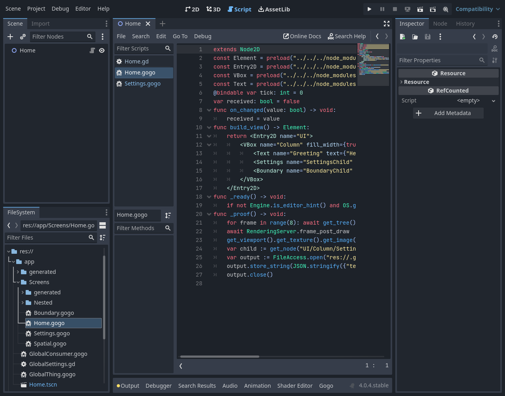

# E07 #135 — project-authored Gogo component tags

Issue [#135](https://github.com/papercraftgames/Estragon/issues/135). Clean native-tested source: `faecb3bf34e50885aa9f25cb1e417f0bd10622e7`; base merged main `0e79d88fa0f5407e922d5468a8fd0eedde66a628` (#134). Subsequent changes record documentation/evidence only. Review-ready implementation; owner review/merge remains outstanding.

A directly authored `<Settings />` discovers the unique eligible project `Settings.gogo`, before generated output exists, and mounts its own view through the existing native Script/Element reconciler. Source-visible imports and Create Node registration are unnecessary. Shared compiler-owned source discovery, coherent build snapshots, mapped private native imports and dependency order preserve the existing actual-path transaction. Explicit aliases choose their resource; local/native/global/duplicate source collisions fail at authored spans. Native CodeEdit completion offers source-qualified choices and inserts ordinary aliases in one undo operation. Add Missing Imports and authored symbol navigation use the same source scope. No authored Script load/instantiation during completion, per-key directory scan, second runtime, user-Node metadata, template or layout change.

## Focused local acceptance

| Official Linux engine | Source/runtime | Stock editor / wall | Restart / wall | Standard / relocated |
| --- | --- | --- | --- | --- |
| 4.0.4 (`fc0b241c9`) | 78 PASS | 41 PASS / 52.86s | 2 PASS / 11.83s | 5 PASS each |
| pinned 4.7.0 (`5b4e0cb0f`) | 80 PASS | 41 PASS / 45.83s | 2 PASS / 10.54s | 5 PASS each |

Complete two-engine focused runner wall: **163.87s**, separate from routine CI’s 60-second budget.

All stages PASS, zero unexpected native errors. Exact commands, status, timing, source/binary provenance, package manifests and native logs are adjacent under [4.0.4](e07/4.0.4/results.json) / [4.7](e07/4.7/results.json). Log copies normalize trailing whitespace only. Frozen install succeeds; `bun run check` typecheck and **30 policy tests PASS**.

Both engines installed identical reproducible development tar SHA-256 `3b6d51f42a87cce90a24e9ed5f05ba2b4aa76a18de98d171fb8c2b3f44a99fc0` directly with Yarn under `res://node_modules/@papercraftgames/estragon/`. Installed bytes and all **51 addon UIDs** remained unchanged; no copying, symlinking or package `.gdignore`. Standard/relocated locations receive only bounded cold source/import probes, including spaces, rather than another editor battery. These are development packages, not release certification.

The owner's `app/Screens/Home.gogo` / `Settings.gogo` repro is freshly authored with direct tags and no Settings preload. Real main/current Play renders the child Text, including an unsaved dependency edit with native autosave disabled. Source/runtime checks cover nested views and 3D siblings, typed attributes/signals/nested Resource types, child reactivity, retained identity, disposal/subscriptions, no-op timestamps/Script identity, source diagnostics and repair. Negative cases cover wrong case, local/native/global/duplicate names, non-Node/required-constructor/abstract components, invalid syntax, self/circular Gogo and ordinary-source preload graphs, explicit stale aliases, moved/deleted source, source-root exclusions/traversal and supported link detection. Generated dependency loss regenerates normally.

Native CodeEdit acceptance/cancel/undo/redo/caret, Tools import undo/redo, original-source symbol lookup, live unsaved metadata, filesystem new/rename/delete, real native global registration/removal, explicit alias authority and matching global/project Script identity, plugin disable/re-enable and restart pass. Existing native progress tasks are allowed to settle between scripted saves/class updates; no production private editor injection or error allowance was added.




## Layout boundary and compatibility

The proof deliberately authors a child Entry and positions its Text. This visible child proves composition; it does not claim outer VBox measurement crosses the ordinary Node2D host. A second plain host mounts an unscoped Text with zero layout size. Parent-layout participation is separately tracked in [#137](https://github.com/papercraftgames/Estragon/issues/137). Scene-owned child projection via `{get_children()}` is separate [#136](https://github.com/papercraftgames/Estragon/issues/136). Minimal 2D/3D starters remain neutral, with no Entry/text defaults.

4.0.4 cannot load Script preloads by `uid://` even when ResourceUID resolves the resource. The compiler lowers only lexer-proven top-level UID preload literals to mapped resource-relative native paths on both engines, preserving the authored declaration and Script identity. Unknown UIDs reject at source. Hygienic private imports also prevent native global-class precedence from changing nested property type namespaces, even for an explicitly declared Gogo alias.

4.0.4 isolated preflight and native symlink introspection remain **BLOCKED/unavailable**; mandatory actual-path validation/rollback and lexical containment pass. 4.7 native symlink escape rejection passes. No new physical-containment guarantee is claimed on 4.0.4. Existing native keep_state initialization limits and accepted hidden-never-associated-tab #44 remain unchanged.

## Existing compiler regression

Both engines pass the bounded six-stage compiler suite: import, frontend (**70 assertions**), registered (**9**), positive publication (**13**), rollback (**17**), fresh failure (**6**). Native semantic/type failures in deliberate negative fixtures are expected and mapped; inherited new-field keep_state initialization remains explicitly BLOCKED rather than claimed fixed. Exact [4.0.4](e07/4.0.4/compiler/results.json) / [4.7](e07/4.7/compiler/results.json) results/provenance/logs are committed. Total suite wall: 12.82s / 9.40s. This is focused regression, not full73/release acceptance.

## Reproduction

Owner-approved Docker container `estragon-e04-local`, image `estragon-p02-linux-env:local`; read-only repo `/repo`, authenticated read-only engines `/engines`, host `/tmp/e04-local` mounted at `/evidence`. Xvfb/Openbox/software OpenGL, isolated self-contained editor settings and empty product compiler-tool PATH. No shared-checkout plugin/preferences changes.

```sh
bun install --frozen-lockfile
bun run check
docker exec -w /tmp -e XDG_RUNTIME_DIR=/tmp/e04-runtime estragon-e04-local \
  xvfb-run -a sh -c 'openbox > /tmp/e07-final-openbox.log 2>&1 & exec corepack yarn@1.22.22 node --experimental-strip-types /repo/tools/check-editor-ux.ts --components --engine 4.0.4=/engines/godot-verified-4.0.4/Godot_v4.0.4-stable_linux.x86_64 --engine 4.7=/engines/godot-verified-4.7/Godot_v4.7-stable_linux.x86_64 --output /evidence/e07-final'
docker exec -w /tmp -e XDG_RUNTIME_DIR=/tmp/e04-runtime estragon-e04-local \
  corepack yarn@1.22.22 node --experimental-strip-types /repo/tools/check-native-addon.ts --suites=compiler --engine 4.0.4=/engines/godot-verified-4.0.4/Godot_v4.0.4-stable_linux.x86_64 --engine 4.7=/engines/godot-verified-4.7/Godot_v4.7-stable_linux.x86_64 --output /tmp/e07-compiler-final
docker cp estragon-e04-local:/tmp/e07-compiler-final /tmp/e04-local/e07-compiler-final
```

Official engine authentication uses `tests/compatibility/linux-engines.json`: 4.0.4 SHA-256 `e9a0db9798cf53385693898af39f98d0065552c0808b9e7eb82cfcb0da880ae9`; pinned 4.7.0 `f85bbc6b15e22416c7d797cd60b63286dd67b9cb13498847056c18520ae55a75`. Raw local evidence remains at the paths above. Automated native captures were inspected on both engines. Manual interactive/macOS smoke, other minors/platforms, exhaustive/full73 regression, release certification and publication consumers were not run. No physical keyboard gate is outstanding.

Development attempts retained FAIL for native test setup/API differences, reserved dictionary-member syntax, an overly narrow cycle location assertion, invalid exported fixture type, global cache notification/removal and progress-task reentry scheduling, native nested-type/global alias precedence, and the newly proven baseline UID loader limitation. These were corrected before the final runs; no errors were waived. Earlier attempts remain under `/tmp/e04-local/e07-*`. CI was not used for development. The live issue/sole PR holds final CI and handoff; owner merges, with no successor started while review is open.
