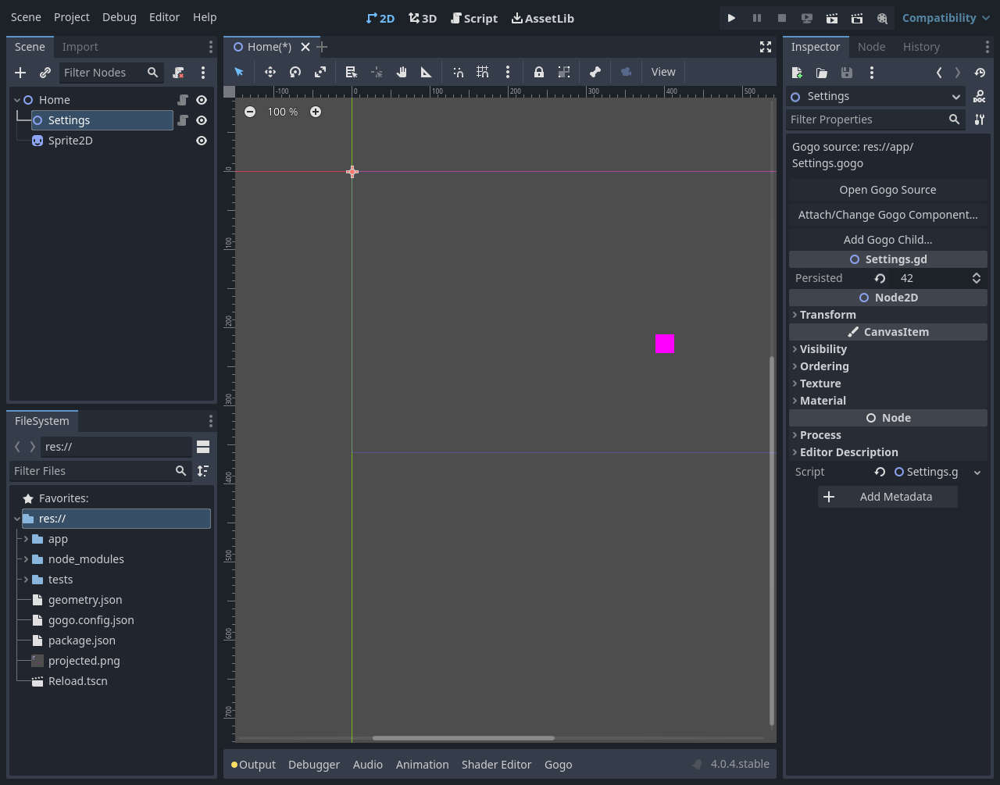
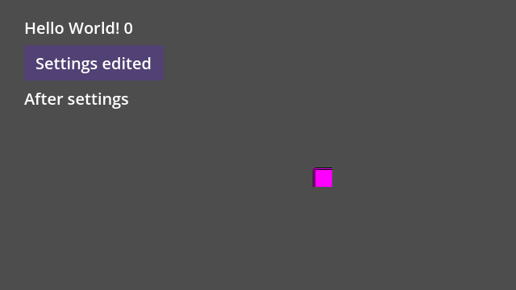

# E08 #136 — borrowed native scene children

Issue [#136](https://github.com/papercraftgames/Estragon/issues/136). Clean native-tested source **`d0c8fc405a3a09153fbb614536f2ca93c5f47933`**, base/current main **`37366933c800cb396ec3e84df2786dad971fb942`** (merged E10 #143). Subsequent edits record evidence/status only. Live issue/sole PR controls owner review/merge; this is focused development acceptance, not release certification.

Ordinary `{get_children()}`/Node child expressions borrow existing persistent direct children. No new tag/variable is injected. Borrowed records never construct, apply properties, free, unmount or reparent those Nodes. External reconciliation identities filter generated output on every pass; external logical parent/order edges reuse the existing coordinator/core and Entry pointer router. Native parent/owner/path, rendering/physics/Z, stored properties and scene editing remain Godot-owned. [Exact contract and boundaries](../SCENE_CHILDREN.md).

## Rendered result and scene editing

Both engines report the same initial geometry ([4.0.4](e08/4.0.4/geometry.json), [4.7](e08/4.7/geometry.json)):

| Item | Native position / allocation | Native parent / owner |
| --- | --- | --- |
| Hello World! 0 | (30,20) / (136,28) | transient managed Column / null |
| Existing Settings action | (30,56) / (106,44) | View beneath existing Settings; Settings remains Home / Home |
| After settings | (30,108) / (130,28) | transient managed Column / null |
| Existing Sprite2D | (400,220), native free positioning | Home / Home |

The Settings action occupies the selected VBox slot, with8-unit gaps and no overlap. It is the same native scene-authored instance across repeated compositions, with its own retained state and actual native pointer callback. The plain Sprite has no fabricated Box footprint. The test fixture's default gradient texture renders its native magenta square; the runnable example has an explicit colored gradient.






Real isolated editor proof uses the existing native Gogo scene picker to add Settings under Home, native scene/EditorUndoRedo APIs to add Sprite2D, edits exported `persisted=42`, selects Settings in the actual Scene dock/Inspector, and saves. Undo/Redo of addition and deletion retains the exact Settings object, owner and exported state. Main/current Play runs actual child game processes, measures allocated positions/size, sends native pointer events, and asserts one click on the authored handler. An unsaved Gogo edit is forced-saved through both Play paths, an invalid close tag blocks Play and preserves output/maps/timestamps/Script identity/UID, repair recovers, and editor process close/restart reopens the authored scene and runs it again. Saved Home has exactly3 authored nodes and no transient GGX. [Native saved scene](e08/4.7/Home.tscn.txt), [runtime PackedScene](e08/4.7/Reload.tscn.txt), [game proof](e08/4.7/e08-game.json.txt).

The checked-in [SceneHome.gogo](../../examples/nested_layout/SceneHome.gogo)/[SceneHome.tscn](../../examples/nested_layout/SceneHome.tscn) uses direct `{get_children()}`, the existing Settings Exit component and a native Sprite2D. Its Godot-only source build, import and actual rendered scene run pass on both engines: Exit at(24,60), size(64,44), Sprite at(400,180), unchanged Home/Settings/Sprite ownership/ancestry. [Exact native log](e08/example-native.txt), [bounded probe](e08/example-probe.gd.txt). It is in the existing configured nested-layout source root; generated GDScript/map and its engine-created stable UID are committed.

## Final clean two-engine focused acceptance

| Official Linux engine | Runtime | Rejection/repair | Editor / wall | Restart / wall |
| --- | --- | --- | --- | --- |
| 4.0.4 (`fc0b241c9`) | 36 PASS / 3.80s | 4 PASS / 2.01s | 24 PASS / 31.91s | 1 PASS / 12.19s |
| pinned4.7.0 (`5b4e0cb0f`) | 36 PASS / 2.75s | 4 PASS / 0.98s | 24 PASS / 29.52s | 1 PASS / 9.91s |

All stages PASS, zero unexpected errors. The negative stage permits exactly4 deliberately triggered diagnostics: source-located duplicate reference, generic previous-tree retention, external reference and a detached reference labeled by name without an invalid native get_path call. Editor negative permits only the established native build-callback failure when deliberately invalid source blocks Play. No leak/error exemption was added. [Exact4.0.4 results](e08/4.0.4/results.json), [4.7 results](e08/4.7/results.json), adjacent logs and provenance preserve actual commands/timing. Complete two-engine local runner wall **106.07s**, distinct from routine CI's60-second wall budget.

Both engines used the identical reproducibly packed development tar SHA-256 **`a9eb230dc04753fad5039df8a2158888a889fc5ef566939765c40ccaeb3c2897`**, installed directly by Yarn at `res://node_modules/@papercraftgames/estragon/`. Installed package bytes/all **55 addon UIDs** remained unchanged; no copying, symlinking or package `.gdignore`. Internal dependencies remain location-independent. Exact [manifest](e08/4.7/package-manifest.json)/[consumer audit](e08/4.7/consumer.json) and both original engine hashes are committed. All153 canonical committed script UID sidecars are valid, unique and paired (explicit archival research excluded). Frozen install, typechecking and **30 policy tests PASS** ([log](e08/static.txt)).

The36 runtime assertions cover native parent/owner/identity/paths, repeated/second+ compositions excluding generated roots, individual Node/helper/array semantics, selected slot order, child bindable growth without Home rerun, conditional release/restoration, root replacement, native add/delete/reorder, mixed unowned runtime children, native free-positioned property edits, pack/save/reload, zero idle polling, transformed parents and preserved rotation/scale, eventful ancestor placement, native participant reorder without Gogo child callbacks, nested hosts/scenes with distinct owners, explicit adapter bounds/origin, native reparent and old-host teardown, initially empty expression observation, detach/reentry, independent Entry scope/position and bounded3D extents/coordinates. Duplicate/external references reject before native commit and repair reuses the previous tree. No transient output is serialized; no user node metadata/helper fields are introduced.

## Existing proportional regressions

Clean source `ccd8c77`, approved4.7 only, existing suites (not full73). These precede only the final detached-reference diagnostic guard/negative; ordinary runtime behavior is identical and was not redundantly retested:

- Native runtime: **18 core +147 runtime** assertions, both editor persistence passes and rendered2D/3D provider/lifecycle captures PASS; suite wall29.43s. [Results/provenance/logs](e08/regression-4.7/runtime/results.json).
- Composition: **49 runtime +42 editor** assertions, build/import and rendered native callbacks/layout/identity/foreign rescue/rollback PASS; suite wall77.30s. [Results](e08/regression-4.7/composition/results.json).
- Lists: **56 runtime +36 rejection/repair +50 editor** assertions, keyed moves/identity, nested arrays, foreign rescue, source errors/repair and graphics PASS; suite wall72.06s. [Results](e08/regression-4.7/lists/results.json). Its existing deliberately returned `self` negative now also permits exactly the new authored-parent diagnostic for that specific fixture; all prior error gates remain.
- L03 nested-layout regression: **37 runtime + actual native Exit quit** PASS, direct Yarn/all55 UIDs unchanged, suite wall10.13s. [Results](e08/regression-4.7/nested-layout/results.json).

The combined runtime/composition/lists runner wall was178.93s. It used a container filesystem output directory to avoid host bind-mount chmod limitations, then copied the evidence to the host. New E08 behavior has the two-engine proof above; existing suites are scoped single-engine corroboration, not a second exhaustive matrix.

## Corrected development failures and native observation

Earlier local attempts are not final acceptance: missing concrete int type in managed-index cleanup, unsupported composed export/bindable fixture annotation (replaced with separate exported field and bindable caption), a fixture name colliding with native Node.duplicate, a nonexistent build CLI path (replaced with existing native distribution build), and a temporary trace inserted in the wrong scope, and an orphan rejection that called native get_path without tree membership (fixed with the final name/path guard and fourth negative). No production workaround/error suppression remains for those mistakes.

A native harness issue was isolated during the single-Node test: direct `const Resource.member` reads of different initially empty dictionaries can share a folded constant in one function on **both approved engines**. The retained [minimal probe](e08/resource-member-probe.gd.txt)/[actual log](e08/resource-member-probe.txt) writes distinct live maps through `get()`, then shows both direct reads returning the projection map, while `get("records")` and `get("projections")` return the distinct correct maps. New E08 assertions inspect live dictionaries through `get()`. Production projection already uses methods/dynamic references; the live registries were correct. This is a bounded native observation, not a claim to fix Godot or certify other releases. Final36/4 assertions use the corrected harness.

## Reproduction and provenance

Owner-approved Docker `estragon-e04-local`, image `estragon-p02-linux-env:local`; repository mounted read-only `/repo`, authenticated engines read-only `/engines`, `/tmp/e04-local` mounted writable `/evidence`. Xvfb/Openbox/software OpenGL, isolated self-contained editor settings, empty compiler-tool PATH. Shared checkout plugin/preferences were not changed. Raw final output: `/tmp/e04-local/e08-final2`; existing regressions: `/tmp/e04-local/e08-regression1` and `/tmp/e04-local/e08-l03-regression1`. [Artifact SHA-256 index](e08/artifact-index.json); archived logs normalize trailing whitespace only.

```sh
bun install --frozen-lockfile
bun run check
docker exec -w /tmp -e XDG_RUNTIME_DIR=/tmp/e04-runtime estragon-e04-local \
  xvfb-run -a sh -c 'openbox > /tmp/e08-final-openbox.log 2>&1 & exec corepack yarn@1.22.22 node --experimental-strip-types /repo/tools/check-scene-projection.ts --editor --engine 4.0.4=/engines/godot-verified-4.0.4/Godot_v4.0.4-stable_linux.x86_64 --engine 4.7=/engines/godot-verified-4.7/Godot_v4.7-stable_linux.x86_64 --output /evidence/e08-final2'
```

Regression: same Docker/Xvfb invocation with `tools/check-native-addon.ts --suites=runtime,composition,lists --engine 4.7=... --output /tmp/e08-regression1`, followed by `docker cp estragon-e04-local:/tmp/e08-regression1 /tmp/e04-local/e08-regression1`; L03 uses `tools/check-nested-layout.ts --engine 4.7=... --output /evidence/e08-l03-regression1`. Each invocation requires a new absolute output directory. Example/probe command paths and driver text are retained adjacent to their logs; they run only the same approved engines.

Approved engine authentication: `tests/compatibility/linux-engines.json`;4.0.4 SHA-256 `e9a0db9798cf53385693898af39f98d0065552c0808b9e7eb82cfcb0da880ae9`; pinned4.7.0 `f85bbc6b15e22416c7d797cd60b63286dd67b9cb13498847056c18520ae55a75`. Native Scene dock/Inspector, projected runtime/game and runnable example captures inspected. Manual interactive/macOS smoke, other minors/platforms, full73/exhaustive suites, release certification/registry/publication were **not run**. No physical keyboard check is required. Accepted #44 and4.0.4 optional isolated-preflight/link-introspection limits remain; mandatory actual-path validation/rollback is preserved. No release/workflow/version/tag/publish/merge change. Required routine PR CI and final head/base/handoff are recorded on the sole PR/issue for owner review.
