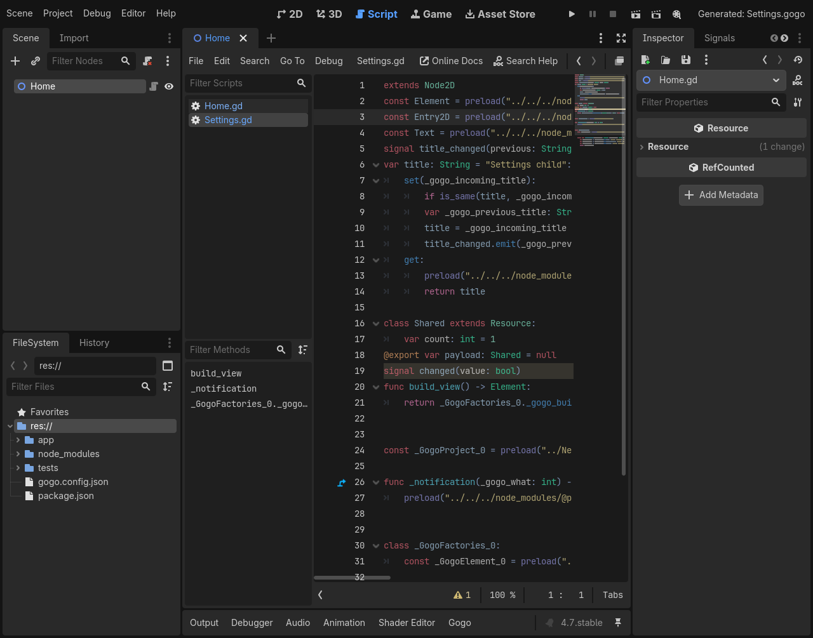
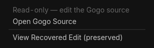
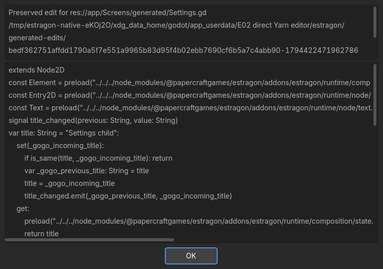

# E09 #139 — safe generated Script inspection

Issue [#139](https://github.com/papercraftgames/Estragon/issues/139). Clean native-tested source `6ca033bd59c14a5d0577b1cc6b1cf1fe16db7607` (full SHA in adjacent provenance); base merged E07 main `f4e4f6a427e462a01c2eb937bca4b2f3c5dfc344`. Final follow-up records documentation/evidence only. Owner review/merge remains outstanding.

**Edit Gogo; inspect generated GDScript.** Verified compiled CodeEdits are read-only and show a compact Generated menu with the exact authored source, Open Gogo Source and persistent recovered-edit access. Inspector Script clicks, script-list selection and native debug-line/breakpoint inspection stay native. Gogo/ordinary GDScript remains editable. There is no automatic debugger redirection, private menu rewrite, alternate editor, runtime or compiler process.

The old post-build whole-buffer reset is replaced with authenticated guard lifecycle, pre-save/build preparation and line-preserving compiled-view synchronization. Already-dirty text is persisted and independently byte-verified before replacement or saved-state tagging. Recovery failure leaves dirty text intact and blocks Estragon build/Play. The toolbar explicitly reports recovered edits or recovery failure. The native selectable viewer shows the exact preserved text and absolute path. Recovery revisions remain under `user://estragon/generated-edits/`, scoped by physical project/output identity; no automatic deletion/application. Disable restores original editability and removes signals/UI; re-enable and restart rediscover prior recovery.

## Focused Linux acceptance

| Official Linux engine | Native editor / wall | Restart / wall | Cold direct / standard / relocated |
| --- | --- | --- | --- |
| 4.0.4 (`fc0b241c9`) | 53 PASS / 44.19s | 5 PASS / 11.89s | 5 PASS each |
| pinned 4.7.0 (`5b4e0cb0f`) | 56 PASS / 39.96s | 6 PASS / 10.04s | 5 PASS each |

Complete two-engine focused runner wall: **128.77s**, separate from routine CI’s60-second budget.

All focused stages PASS with **zero unexpected native errors**. One expected native EditorPlugin build-callback failure records intentional invalid-source main Play rejection. Exact commands/status/timing: [4.0.4](e09/4.0.4/results.json) and [4.7](e09/4.7/results.json). Adjacent raw native logs normalize trailing whitespace only. Frozen `bun install --frozen-lockfile` and `bun run check` succeed: typecheck plus **30 policy tests PASS**.

Both engines directly install the same reproducible development tar SHA-256 `bc0103ac1cc2f045c768ea449f2012dd1efb785fa1c8aa1a1a3782024bfed8e5` through Yarn at `res://node_modules/@papercraftgames/estragon/`. Installed bytes and **52 addon UIDs** remain unchanged. No package copying/symlinking/ignore fallback. Bounded standard and relocated (including spaces) source/import probes replace additional editor batteries. These are development artifacts, not release certification.

Verified owner scenario: attached native Home.gd composes Settings.gogo; selecting Settings.gd visibly identifies generated origin, real keyboard input cannot edit it, and the menu opens exact Settings.gogo. Native Inspector Script click and exact-path Script-list selection keep compiled inspection available; source-map target/caret remain editable. Main/current Play render the Settings child. Source changes with compiled tab open synchronize bytes and cached Script; failed Gogo build/main Play retain generated bytes/maps/timestamps/UID/cache identity, then recover after repair. CRLF normalization does not manufacture recovery.

Dirty generated adoption on enable preserves exact UTF-8 text before restoration. Subsequent native edit signals also preserve first; deliberately obstructing the recovery directory blocks build without marking the buffer saved or replacing its text. Repair persists it and restores compiled inspection. Recovered text remains discoverable after editor restart. The native recovery window fits the editor viewport on both engines; its source/path and content are selectable and scrollable.

Ordinary `.gd`, unrelated generated-folder `.gd`, malformed/unrelated/mismatched maps and a missing-source first-open fixture remain editable. Previously verified tabs explain missing source/map state without erasing text or navigating to nonexistent sources. Unicode paths and duplicate Settings basenames navigate by exact source identity. Native breakpoint/no-op compiled inspection works on read-only output. Existing gutter locations are retained by line updates where lines remain; semantic breakpoint relocation after generated source changes remains Godot's responsibility.







## Authentication and public APIs

E05 `source_for` delegates to a canonical `source_path` map/output association: project resource paths only, `.gogo` source identity and exact BuildService output mapping. A generated folder/basename alone never authorizes protection. The guard requires existing source/output, v1 format/content/segments and matching generated bytes. New v1 maps add `generatedHash` without changing generated GDScript; legacy maps use deterministic emission of their recorded source with the original diagnostic source name. Missing-source first-open notices are explicitly unverified and informational. Prior trusted tabs stay inspect-only during a temporary broken association; reload/unload restores prior editability.

Uses public [TextEdit editability/line APIs](https://docs.godotengine.org/en/4.0/classes/class_textedit.html), [CodeEdit breakpoints](https://docs.godotengine.org/en/4.0/classes/class_codeedit.html), [ScriptEditor current Script/editor](https://docs.godotengine.org/en/4.0/classes/class_scripteditor.html), EditorPlugin toolbar and native MenuButton/AcceptDialog. Exact resource association reuses the existing bounded E01 adapter for noncurrent tabs; source opening reuses E05/E01 FileSystemDock full-path activation. No private ScriptEditor methods, menu rewrites or guessed basenames. Physical keyboard tests are not a gate; native automated input and captures are separate evidence.

## Proportional compiler regression

At clean `89e29d0c1606b5f1734b77eaf33e2131a94c7900`, both engines passed the six existing compiler stages: import, frontend (**70 assertions**), registered (**9**), positive (**13**), rollback (**17**), fresh failure (**6**). Compiler code has not changed since that run; later edits are editor/fixture/docs only. Suite wall 12.50s/9.91s. Exact [4.0.4](e09/4.0.4/compiler/results.json) / [4.7](e09/4.7/compiler/results.json) logs/provenance retained. Intentional native semantic failures are expected fixture results. Native keep_state initialization of newly added inherited fields remains **BLOCKED**, unchanged. This is not full73/release proof.

## Reproduction, failures and limits

Owner-approved Docker container `estragon-e04-local`, image `estragon-p02-linux-env:local`; read-only repository `/repo`, authenticated engines `/engines`, host `/tmp/e04-local` mounted `/evidence`; Xvfb/Openbox/software OpenGL, isolated self-contained settings and empty product compiler-tool PATH. Shared-checkout addon/preferences are untouched.

```sh
bun install --frozen-lockfile
bun run check
docker exec -w /tmp -e XDG_RUNTIME_DIR=/tmp/e04-runtime estragon-e04-local \
  xvfb-run -a sh -c 'openbox > /tmp/e09-ready-openbox.log 2>&1 & exec corepack yarn@1.22.22 node --experimental-strip-types /repo/tools/check-editor-ux.ts --generated --engine 4.0.4=/engines/godot-verified-4.0.4/Godot_v4.0.4-stable_linux.x86_64 --engine 4.7=/engines/godot-verified-4.7/Godot_v4.7-stable_linux.x86_64 --output /evidence/e09-ready-2'
docker exec -w /tmp -e XDG_RUNTIME_DIR=/tmp/e04-runtime estragon-e04-local \
  corepack yarn@1.22.22 node --experimental-strip-types /repo/tools/check-native-addon.ts --suites=compiler --engine 4.0.4=/engines/godot-verified-4.0.4/Godot_v4.0.4-stable_linux.x86_64 --engine 4.7=/engines/godot-verified-4.7/Godot_v4.7-stable_linux.x86_64 --output /tmp/e09-compiler
docker cp estragon-e04-local:/tmp/e09-compiler /tmp/e04-local/e09-compiler
```

Binary authentication: `tests/compatibility/linux-engines.json`; 4.0.4 `e9a0db9798cf53385693898af39f98d0065552c0808b9e7eb82cfcb0da880ae9`, pinned 4.7.0 `f85bbc6b15e22416c7d797cd60b63286dd67b9cb13498847056c18520ae55a75`. On continuation, host cleanup had removed the mounted engine binaries: 4.7 was restored from a matching cached binary and 4.0.4 redownloaded through the existing official archive/SHA256/SHA512 authenticator. No extra engine version/platform was launched.

Earlier `/tmp/e04-local/e09-dev-*` and `e09-final` attempts remain truthful FAIL/partial proof: reserved native token and unsupported test-only input APIs, an off-screen toolbar action, unscanned newly authored fixture files preventing navigation, legacy relative diagnostic-name mismatch, restart layout/identity ordering and native breakpoint/shaped-text leaks. Whole-buffer assignment cleared native gutters; line operations avoid unnecessary removals. Native debugger breakpoint removal itself detaches TreeItems without freeing them in the tested 4.7 source; the breakpoint proof exercises inspection/no-op refresh separately, with no private workaround or error allowance. A verbose diagnostic attempt also exposed a container D-Bus configuration error. Screenshot QA caught the oversized 4.7 wrapping-label recovery window after functional checks passed; a bounded TextEdit path display and viewport assertion correct it in the final run. Engine-restoration setup attempts failed before any product test and are not claimed passing evidence.

Automated native captures inspected on both engines. Manual interactive/macOS smoke, other engine minors/platforms, full73/exhaustive regression, release certification, publication/registry consumers and release/version/workflow changes were not run. Godot4.0.4 isolated preflight/link introspection and accepted #44 highlighter limits remain unchanged; actual-path transactional validation remains mandatory. Routine CI is independent verification, not the development loop. The live issue/sole PR contains final CI, exact head/base and durable handoff. No merge/tag/release/publication authorized.
