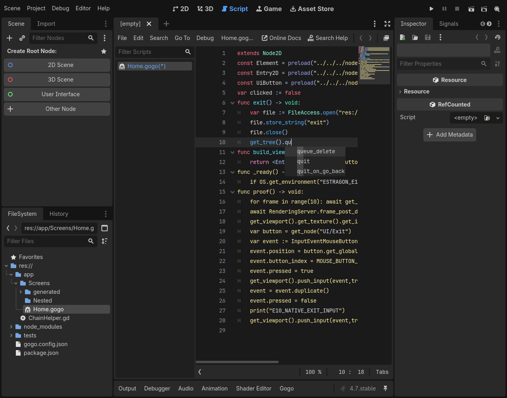

# E10 #141 — typed method-return chain completion

Issue [#141](https://github.com/papercraftgames/Estragon/issues/141). Clean final native-tested implementation: `32d61f8ef2cc0cb0143812398f72b187a61230b4`; base merged L03 main `077018981bfec04254e865da6afb71196df45597`. Subsequent edits record documentation/evidence only. Owner review/merge remains outstanding.

`get_tree().qu` now uses Node.get_tree's native **SceneTree** return metadata to offer `quit`; accepting it inserts `quit()` through the existing CodeEdit popup/undo path. `get_tree().quit(` shows the native signature. `SceneTree.quit()` is the API; no SceneTree.exit() is invented. Other matching SceneTree members, including queue_delete and quit_on_go_back, remain legitimate prefix matches. Signal/Callable GGX attributes retain method references instead of invoking the selected handler.

The bounded postfix parser reuses cached lexical tokens and ClassDB metadata. It resolves self/typed property/argument/local access, native method/property returns, grouping, balanced opaque method arguments, explicit typed source returns and recognized imported/native/global Script types. It never executes arguments/getters or loads/instantiates/reloads authored Scripts, and never queries live SceneTree objects to guess return types. Source methods/dependency buffers use safe lexical declarations; native return identity cannot be redirected by a same-named authored alias. Function/indentation scopes prevent local names from leaking into later, exited or sibling scopes. No compiler/runtime/layout/workflow change.

## Focused local acceptance

| Official Linux engine | Source chain assertions | Native editor / wall | Restart / wall | Standard / relocated |
| --- | --- | --- | --- | --- |
| 4.0.4 (`fc0b241c9`) | 52 PASS | 46 PASS / 19.65s | 4 PASS / 11.22s | 5 PASS each |
| pinned4.7.0 (`5b4e0cb0f`) | 52 PASS | 46 PASS / 19.79s | 4 PASS / 9.11s | 5 PASS each |

Complete focused two-engine runner wall: **84.17s**, separate from routine CI’s60-second budget.

All stages PASS, zero unexpected native errors. Exact commands/status/timing and provenance: [4.0.4](e10/4.0.4/results.json), [4.7](e10/4.7/results.json); adjacent raw native logs normalize trailing whitespace only. Frozen install and `bun run check` typecheck/**30 policy tests PASS**.

Both engines directly installed the same reproducible development tar SHA-256 `4ee30499db1ab07952a1bc6d4c793c0309a312aac6bcb20ecc7d4c8c63195765` with Yarn at `res://node_modules/@papercraftgames/estragon/`. Installed addon bytes and **54 addon UIDs** remain unchanged. No copy/symlink/package-ignore fallback. Standard/relocated (including spaces) paths receive bounded existing source/import probes, rather than another editor battery. This is a development package, not release certification.

The actual authenticated Gogo CodeEdit popup offers `quit` with KIND_FUNCTION, invocation text and native signature. Native confirmation selects it, inserts the exact expected source, and one undo/redo operation restores source/caret. The accepted source compiles through existing actual-path validation. A real entry-scoped button in the child game invokes the completed exit handler; a marker proves handler activation and the game actually stops through get_tree().quit() in main/current Play and after editor restart. Native viewport/self/typed-variable/nested-argument/source-return acceptance, dynamic suppression, comments/strings, GGX tag/attribute code, chained call hint and authored source-map target/caret pass. Ordinary `.gd` remains editable in its native language editor with no Gogo acceptance script/services installed.

The 52 source assertions cover both Node2D/Node3D inheritance, get_tree/get_viewport/get_node conservative types, typed symbols/returns and unsaved dependency metadata, native returned properties, nested parentheses/opaque strings, multiline balanced arguments, correct prefixes and existing parentheses, unknown/Variant/void/broken/indexed/qualified types, per-function/later-local/indentation-block scope, Callable signal references, native return alias isolation and depth/scan bounds. Source dependency return inference leaves ResourceLoader.has_cached false, proving it does not load that authored Script.




## Bounds and retained behavior

Receiver collection is capped at 16 lines,4096 characters and256 cached tokens; recursive postfix resolution caps at 24 steps. Method arguments are skipped with balanced (),[] and{} and strings remain opaque. Native return/property classes use ClassDB metadata, including inheritance. get_node returns Node conservatively; no node-path-specific runtime guessing. Explicit source-return types use declaration/import metadata. Unknown/Variant/void, unsupported indexing/operator/cast forms, unresolved qualified types and malformed/over-budget chains safely return no fabricated members. Native semantic compilation remains authoritative for call validity/arguments.

This is not the private GDScript completion analyzer or full language-server parity. There is no general inferred assignment/return engine, arbitrary builtin value/collection-method inference, dynamic Callable-return inference, overload/argument-value analysis or complete lambda/inner-class/multiline declaration scope/type analysis. Call hints follow a statically known callable; arbitrary unfinished nested argument/overload parity is not claimed. The existing declaration index is refreshed when a buffer changes; repeated requests reuse it and ClassDB caches. No whole-file regex substitution or runtime evaluation is added.

Member-method selection supplies `()` when authoring a call, while retaining an existing opening parenthesis. An identifiable signal/Callable GGX attribute retains a function reference. Comments and ordinary string contents do not offer code chains; existing path-string completion remains its separate bounded feature. GGX tag/property/import behavior, ordinary GDScript completion, source-map navigation and native undo remain on the same integration. Existing highlighter#44 and compatibility limits remain unchanged.

## Focused existing editor regression

The existing `--creation` editor-UX profile passes on official Linux4.7 at clean `66649fc039b3c406b1de3eb9197278774ab26e7c`: **33 lexical/template assertions** per direct/relocated/standard location, **143 editor +15 restart assertions**, including native creation/menu, highlighting/completion/import/undo/lifecycle and actual main/current child Play. [Results](e10/editor-regression-4.7/results.json), provenance/logs/captures retained. Later final changes only strengthen typed scope, native return identity and Callable attribute acceptance; the final clean two-engine E10 run above covers those changes. This earlier focused regression is corroboration at its recorded source, not relabeled as final-source evidence. No full73 or additional engine versions/platforms.

## Reproduction and provenance

Owner-approved Docker container `estragon-e04-local`, image `estragon-p02-linux-env:local`; read-only repository `/repo`, authenticated engines `/engines`, host `/tmp/e04-local` mounted `/evidence`. Xvfb/Openbox/software OpenGL; isolated self-contained editor settings with empty product compiler-tool PATH. No shared-checkout plugin/preferences changes.

```sh
bun install --frozen-lockfile
bun run check
docker exec -w /tmp -e XDG_RUNTIME_DIR=/tmp/e04-runtime estragon-e04-local \
  xvfb-run -a sh -c 'openbox > /tmp/e10-reviewed-openbox.log 2>&1 & exec corepack yarn@1.22.22 node --experimental-strip-types /repo/tools/check-editor-ux.ts --chains --engine 4.0.4=/engines/godot-verified-4.0.4/Godot_v4.0.4-stable_linux.x86_64 --engine 4.7=/engines/godot-verified-4.7/Godot_v4.7-stable_linux.x86_64 --output /evidence/e10-reviewed'
```

Existing focused regression uses the same Docker/Xvfb command with `--creation --engine 4.7=... --output /evidence/e10-editor-regression`. Actual complete stage commands are in results. Raw outputs retained at those host paths. Source probe-only development is `--chains --probe-only`. New absolute output directories required.

Approved engine authentication uses `tests/compatibility/linux-engines.json`: 4.0.4 binary SHA-256 `e9a0db9798cf53385693898af39f98d0065552c0808b9e7eb82cfcb0da880ae9`; pinned4.7.0 `f85bbc6b15e22416c7d797cd60b63286dd67b9cb13498847056c18520ae55a75`. Native popup/game captures inspected on both engines. Manual interactive/macOS, other minors/platforms, full73/exhaustive regression and release/publication/registry consumers were not run; no physical-key gate is outstanding.

Development failures were fixture-only: untyped loop-derived String warning; a popup display suffix vs exact tag-name assertion; incorrect expectation that prefix qu has only one valid SceneTree candidate; and static checks started before the canonical new fixture UIDs were generated/committed. These were corrected without filtering valid metadata or allowing errors. Earlier e10-dev/ready/final attempts remain retained separately. Final reviewed source includes nested-block/Callable/native alias guards and all passes above. No compiler/runtime/layout/release/version/tag/workflow/publication changes, no merge. Live issue/sole PR records final head/base, CI and durable handoff.
