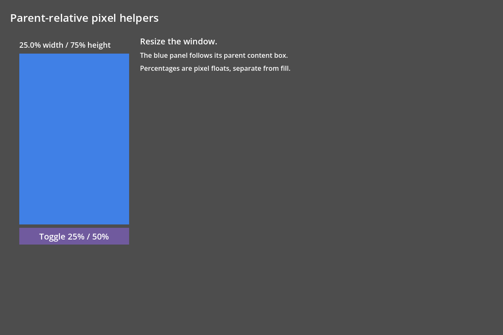

# L02 — observed parent-relative pixels

Issue [#129](https://github.com/papercraftgames/Estragon/issues/129); base merged L01#153 **`d89ea009fd65b22a650c975dd1d93bc66ec4c9cf`**. Native helper/core implementation and proportional regressions are clean **`d7abd99e25cff63c35a25c7339533602d76ddd99`**. Final helper completion correction is clean **`8c10628`**. This is focused local review evidence, not release certification; live issue/sole PR controls review/merge state.

## Contract and implementation

[Public API and limits](../PARENT_PIXELS.md), [runnable child](../../examples/parent_pixels/ResponsivePanel.gogo), [scene](../../examples/parent_pixels/ResponsiveHome.tscn). Typed `Pixels.parent_width(self,50.0)` / `parent_height(self,75.0)` return ordinary floats for the composing host's containing2D layout participant content box. Child root props use normal observed composition and changed-property reconciliation. The core remains independent of the manager; the optional composition-layer adapter observes its changed arranged-reference/parent-edge signals. No per-frame scanning, helper Node, user metadata, unit grammar/type, target-dependent compiler rewrite or second binding/layout engine is introduced.

Fixed bounds, positive viewport-backed Entry axes and fill allocation anchored through independent ancestors provide reference geometry. Padding is subtracted/clamped once; margins/gaps retain L01 arithmetic. Auto child-dependent axes use deterministic0 fallback and do not solve cyclic fixed points. Width/height qualify independently; availability changes wake subscribers even if arranged bounds coincide. Transparent Gogo proxies add no content box and cannot anchor their own percent child. Missing/plain/Control/3D contexts and independent scope boundaries keep the documented bounded behavior. Inline nested targets use normal child Gogo components; self is a component host, never an inferred inline target.

Fractional, zero and above100 percentages are supported. Negative/NAN/INF, mismatched/outside-composition context and results beyond native finite vector storage return0 with an actionable warning. Quoted `50%`/units remain authored errors. Percent pixels are fixed dimensions, separate from fill shares; multiple percent siblings can overflow alongside gaps/margins/native minimum floors.

Completion validation exposed an existing ordinary preload receiver bug: an untyped const declaration masked its Script alias. `_chain` now resolves untyped constant preload aliases as Script receivers, while local/typed shadows retain authority. A final guard also requires class scope before resolving the alias, so function-local constants continue to shadow it. Three standalone completion assertions exercise imported/local-constant/typed-local receivers on both approved engines. The real native CodeEdit proof exercises the Pixels method in unchanged valid source; no injected editor analyzer or authored Script evaluation was added.

## Focused acceptance

Official Linux **4.0.4.stable.official.fc0b241c9** and pinned **4.7.stable.official.5b4e0cb0f** only; exact authenticated binary hashes/commands/source heads are in provenance. Fresh direct-Yarn consumers load the actual node_modules package without copying/symlinking/ignoring it. Native settings and compiler-tool PATH are isolated. No shared-checkout plugin preference is changed.

Both engines pass **49 runtime assertions**:50%/75% through640×400,800×600,520×320 parent sizes; immediate nested content references; fixed/gap/margin/fill reservations; retained/keyed identity and actual pointer dispatch; parent padding/margin and dynamic percent changes; fractional/zero/above100 overflow; viewport-backed fill; native reparent and stale-source cleanup; auto/cyclic/zero-content and equal-size auto-to-fixed policy changes; transparent roots; missing/independent scopes; invalid/native-vector overflow; multiple siblings/native minimum floors; logical E08 projection without native reparent; scene pack/reopen; current Counter and responsive example; source diagnostics, Script/map/cache preservation and repair; idle work and balanced observation context stacks.

The editor proof uses actual CodeEdit helper completion, installed native imports/maps, current/main games and restart. Every child game follows three parent resizes and retains its panel identity; measured output is exactly **300×270 from600×360 content**, **380×420 from760×560**, **240×210 from480×280**. One native button callback follows the resized geometry. No physical keypress requirement is introduced. 4.0.4 optional isolated preflight/symlink introspection remains unavailable/BLOCKED; mandatory actual-path semantic validation succeeds.

## Final results and package integrity

All final attempts used the same development tar **`e2f85fdbe0c51b5add41598624f660f2a605d23b80a45be46382350246dd5cd8`** at clean **`8c10628424f49fa8e454245e8f2f1bccd674fd8f`**. The successful4.0.4 editor retry and4.7 full run audit all **59** installed addon UID sidecars/bytes unchanged at completion. The preceding4.0.4 runtime49 stage passed in the first final run; its final integrity audit was not reached because restart failed. Matching phase manifests bind those exact runtime bytes to the same package; the later successful editor retry completes the installed-byte audit independently.

| Engine / phase | Runtime | Editor / restart | Runtime / editor / restart wall |
| --- | --- | --- | --- |
|4.0.4 first final |49 PASS |5 PASS / native startup FAIL |16.51 /36.94 /8.08 seconds |
|4.0.4 fresh unchanged retry |not repeated |5 /2 PASS |— /33.21 /19.79 seconds |
|4.7 final |49 PASS |5 /2 PASS |7.79 /25.22 /12.58 seconds |

[4.0.4 first attempt results](l02/failed-restart/4.0.4/results.json), [4.0.4 successful retry](l02/editor-retry/4.0.4/results.json), [4.7 complete results](l02/acceptance/4.7/results.json). Whole retry runner62.09s; whole4.7 runner53.76s. These focused local editor runs are independent of routine CI's60-second budget. [4.0.4 consumer](l02/editor-retry/4.0.4/consumer.json), [4.7 consumer](l02/acceptance/4.7/consumer.json), [artifact hashes](l02/artifact-index.json).



[640 parent frame](l02/acceptance/4.7/parent-640.png), [800 parent frame](l02/acceptance/4.7/parent-800.png), [520 parent frame](l02/acceptance/4.7/parent-520.png), [overflow](l02/acceptance/4.7/overflow.png), [actual editor game](l02/editor-retry/4.0.4/editor-game.png). Captures were inspected against recorded pixel dimensions and native pointer tests.

## Final local-shadow completion refinement

Final review tightened preload receiver resolution to class-scope constants, preserving local constant shadowing. At clean `dec589fe69836b875e4536416a194dd14780982f` (4.0.4) / documentation-only successor `c392394c643274f135d8a66cd2c6b8899b43c37c` (4.7), **3 standalone completion assertions +5 editor +2 restart assertions PASS per engine**. Both use identical final tar **`9232a6f9980b22ddba539f92e5603ff3d3dfc55ccb7f7eae0b66da9d3a5ba524`**, with all59 installed addon UIDs/bytes unchanged. Only the completion guard changed from runtime-verified8c10628; helper/core/layout/runtime fixtures are unchanged, so runtime was not repeated. [Final4.0.4 results](l02/final-editor/4.0.4/results.json), [final4.7 results](l02/final-editor/4.7/results.json).4.0.4 completion/build/editor/restart wall0.83/2.63/30.21/18.83s;4.7 editor22.83s, complete4.7 runner45.28s. Exact remaining timings are in results.

The first standalone completion fixture attempt failed4.0.4 String inference; a typed String corrected the fixture. A later4.0.4 completion/editor/restart run passed but the runner refused to package4.7 because the evidence document was edited mid-run. The clean-source guard was preserved; the documentation was committed and only the remaining4.7 editor proof ran. No failed native checks were bypassed, no runtime/package artifacts were patched, and no unchanged4.0.4 proof was repeated for that packaging interruption.

## Proportional regression and static checks

At clean `d7abd99`, with final layout/helper runtime bytes:

- Existing approved4.7 native runtime regression: **18 core +147 runtime**, both native persistence editor passes and2D/3D graphics/provider/lifecycle checks **PASS**,44.67s. [Results](l02/regression-4.7/results.json). This covers pre-existing zero-inset geometry, boundaries, native remove/reparent/free and pack/reopen.
- Existing approved4.7 composition: **49 runtime +42 real editor assertions**, build/import/visual stages **PASS**,126.25s. [Results](l02/composition-4.7/results.json). Getter scopes/subscription cleanup, weak native lifecycle, retained composition and actual-path editor negative/repair behavior remain intact. Its established negative fixture admits only exact intentional diagnostics, never unexpected errors/leaks.
- `bun install --frozen-lockfile` and final `bun run check`: typecheck +**30 policies PASS**. [Log](l02/static.txt). Canonical audit: **177 unique paired Script UIDs**, archived research excluded ([audit](l02/uids.txt)). New canonical-path sidecars and checked-in generated example/maps remain stable. Native isolated4.7 generated the example ([build](l02/example-build.txt)).

## Corrected and failed attempts

The first fixture named its source Panel, correctly colliding with Godot Panel; it was renamed PercentPanel, with no production tag remapping. Initial4.0.4 direct-Yarn runtime/game behavior passed but helper CodeEdit completion failed; the alias bug described above was corrected in `8c10628`. The new standalone completion fixture initially needed an explicitly typed source String for4.0.4 inference; that harness parse failure was corrected before final completion/editor acceptance. A composition evidence-copy attempt failed on host-mount chmod EACCES; unchanged tests then passed in container-local storage. These are not claimed as successful acceptance attempts.

The first final4.0.4 run passed runtime49 and editor5, including completion and both games, then restart failed before the test plugin ran with native RID/texture initialization errors (`Initializing already initialized RID`, `!mem`, `!texture`). The runner rejected the attempt and retained FAIL. No exemption or production workaround was added; one unchanged fresh editor-only retry was used to check reproducibility. Failed attempt logs/results are archived separately. This bounded observation does not establish a general upstream fix or root cause.

## Limits and reproduction

Manual interactive/macOS Godot4.7 smoke, other engines/platforms, full73, release certification/registry/publication were **not run**. No Assets/version/release/tag/account/workflow/merge changes. General units/styles, arbitrary cross-sibling/self geometry constraints, inline target inference, native Control custom percent props and3D conversion remain out of scope. All rendered captures were inspected alongside exact geometry/input assertions; headless tests alone are not called visual evidence.

Owner-approved Docker `estragon-e04-local`, image `estragon-p02-linux-env:local`; read-only repository `/repo`, authenticated engines `/engines`, host `/tmp/e04-local` at `/evidence`. Xvfb/Openbox/Mesa software graphics; self-contained settings and no external compiler-tool PATH. Archive logs trim trailing whitespace/rename.log to.txt; result records preserve original stage commands. Use new absolute output paths.

```sh
bun install --frozen-lockfile
bun run check
node --experimental-strip-types --input-type=module -e 'import {auditNativeSource} from "./tools/audit-native-source.ts"; console.log(JSON.stringify(auditNativeSource()));'
docker exec -w /tmp -e XDG_RUNTIME_DIR=/tmp/e04-runtime estragon-e04-local xvfb-run -a sh -c 'openbox >/tmp/l02-final-openbox.log 2>&1 & exec corepack yarn@1.22.22 node --experimental-strip-types /repo/tools/check-parent-pixels.ts --editor --engine 4.0.4=/engines/godot-verified-4.0.4/Godot_v4.0.4-stable_linux.x86_64 --engine 4.7=/engines/godot-verified-4.7/Godot_v4.7-stable_linux.x86_64 --output /evidence/l02-final'
docker exec -w /tmp -e XDG_RUNTIME_DIR=/tmp/e04-runtime estragon-e04-local xvfb-run -a sh -c 'openbox >/tmp/l02-editor40-openbox.log 2>&1 & exec corepack yarn@1.22.22 node --experimental-strip-types /repo/tools/check-parent-pixels.ts --editor-only --engine 4.0.4=/engines/godot-verified-4.0.4/Godot_v4.0.4-stable_linux.x86_64 --output /evidence/l02-editor40'
docker exec -w /tmp -e XDG_RUNTIME_DIR=/tmp/e04-runtime estragon-e04-local xvfb-run -a sh -c 'openbox >/tmp/l02-final47-openbox.log 2>&1 & exec corepack yarn@1.22.22 node --experimental-strip-types /repo/tools/check-parent-pixels.ts --editor --engine 4.7=/engines/godot-verified-4.7/Godot_v4.7-stable_linux.x86_64 --output /evidence/l02-final47'
```

Existing regression commands through the same Xvfb/Yarn entry point are `check-node-runtime.ts --graphics --engine 4.7=… --output /evidence/l02-core` and `check-composition.ts --engine 4.7=… --output /tmp/l02-composition2` (use separate `--engine 4.7=…` arguments as recorded in provenance). Raw composition output was copied out after completion. Live issue/sole PR records final head/base, required CI timing and durable review handoff. No auto-merge.
