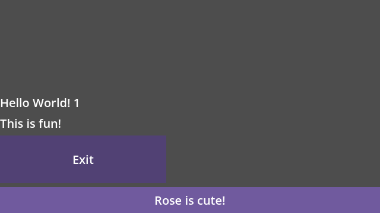

# L03 #137 — nested Gogo layout continuity

Issue [#137](https://github.com/papercraftgames/Estragon/issues/137). Clean final native-tested source: `03790b4136b83d36fc8f3c846296a05556bff4be`; base merged E09 main `cf1a0fedbf4d7215ecaa86dbf3c50a2f310bc4a2`. Subsequent edits record docs/evidence only. Owner review/merge remains outstanding.

A normal spatial Gogo host now forwards its **one managed view root** into the parent's existing layout core. HBox/VBox/Text/EstragonButton roots measure and occupy their declared sibling slot without a child Entry. The existing Computation owns a coordinator bridge and weak lookup; no user fields/metadata or helper Nodes are introduced. Parent placement moves the real host once, and the root is arranged at zero local offset. Natural/fixed/fill constraints, invalidation and native input use the existing coordinator/core/Entry router, with no second layout engine, reconciliation path or per-frame render loop.

## Owner reproduction: rendered before and after

The fixture creates Home/Settings/Rose in a fresh direct-Yarn project. Home returns one Entry2D with a fill VBox, flexible spacer, two outer Texts, Settings and Rose. Settings returns HBox/EstragonButton and Rose returns HBox/Text. `UiButton` is an ordinary explicit alias for EstragonButton; bare Godot `Button` is never remapped.

| Descendant | Before position / size | After position / size |
| --- | --- | --- |
| Hello World! | (0,304) / (119,28) | (0,232) / (119,28) |
| This is fun! | (0,332) / (104,28) | (0,260) / (104,28) |
| Settings Exit | (0,0) / (0,0) | (0,288) / (64,44) |
| Rose is cute! | (0,0) / (0,0) | (0,332) / (120,28) |

Before: clean `75306600eb3413df9c3ad24b2d7814ea5449fecc` (full SHA in [provenance](l03/before-4.7/provenance.json)), production runtime identical to base main. [Measured before](l03/before-4.7/before.json) / [after](l03/4.7/after.json). The baseline fixture proves missing text/zero allocation; it does not claim to reproduce every native-Control rendering detail in the owner's macOS screenshot. Both approved final engines report the same allocations. Actual native pointer activation of the Settings button prints `L03_EXIT_QUIT` and calls the authored `get_tree().quit()` in a separate game process.





## Final focused acceptance

| Official Linux engine | Runtime | Exit/input | Native editor / wall | Restart / wall |
| --- | --- | --- | --- | --- |
| 4.0.4 (`fc0b241c9`) | 37 PASS | actual quit PASS | 12 PASS / 33.30s | 1 PASS / 13.35s |
| pinned 4.7.0 (`5b4e0cb0f`) | 37 PASS | actual quit PASS | 12 PASS / 29.47s | 1 PASS / 11.06s |

All focused stages PASS, zero unexpected native errors. One deliberate invalid-source Play rejection emits the established native EditorPlugin callback-failed diagnostic. Complete two-engine focused runner wall **108.61s**, separate from routine CI's60-second budget. Exact [4.0.4](l03/4.0.4/results.json) / [4.7](l03/4.7/results.json) command arrays, status, timing, provenance, package manifest and adjacent logs are committed. Log copies normalize trailing whitespace only. Frozen install succeeds; final retained tooling typecheck and **30 policy tests PASS**.

Both engines test the identical reproducible development tar SHA-256 `874ef7e108a57ba93ff1295314ec1a25c43f5de3c0569a07032087251f134430`, installed directly with Yarn at `res://node_modules/@papercraftgames/estragon/`. Installed bytes and all **54 addon UIDs** remain unchanged. No copy/symlink/package-ignore fallback. Production internal dependencies are Script-relative. This is a development package, not release certification.

Runtime acceptance verifies natural/filled distinct buttons, native Rose pointer presses, actual Exit quit, Text/HBox/VBox roots and multiple host levels, fixed root dimensions overriding fill, gaps, native resize, scale/rotation preservation and no duplicate translation. Child bindable intrinsic/shape changes reflow subsequent siblings while parent computation run count remains unchanged; interested child reruns once, and idle layout/composition counters remain unchanged. Keyed reorder retains native identity/local state. Native reparent changes layout/input scope without replacing host state; removal/re-entry, replacement by direct Text/independent Entry and restoration, disposal and registry cleanup pass. Unmanaged scene children stay put and unmeasured. PackedScene saves only authored host, and reopen remounts one correctly allocated view. Bounded 3D native participants forward extents/reactive sibling placement; incompatible2D/3D remains unallocated.

Real native editor acceptance runs with isolated native autosave disabled: saved main/current Play, an unsaved Settings dependency saved before both paths and visibly reflected in the child game, invalid source blocking, exact bytes/maps/timestamps/cache/UID rollback, repair, authored scene save and editor restart. The saved scene has one authored host and no serialized transient GGX. Rendered game proof checks positive button/Text sizes, order and no duplicated children. The example scene [Home.tscn](../../examples/nested_layout/Home.tscn) and Home/Settings/Rose sources/generated Scripts/maps/UIDs are checked in and included in the configured example roots.

## Boundaries and lifecycle

The coordinator lookup recognizes existing native participants plus registered spatial composition hosts. The composition bridge registers before mounting nested output, selects only its own managed root, subscribes to that model's invalidation and forwards requested/fill constraints. It stops/disconnects/unregisters on native exit/dispose; entry reuses the same coordinator and view identities. The baseline moved-in-parent notification is forwarded through the existing generated lifecycle so Godot4.0.4 keyed reorder updates layout order. Newer child-order signals continue to use the existing path.

Plain native Nodes remain boundaries. Independent Entry, non-layout/plain and cross-dimensional roots contribute zero to the host's parent slot; they do not gain a universal footprint or silently allocate a subtree. A zero-sized slot can still contribute the parent's normal sibling gap. Explicit Entry keeps a separate scope/position. Native participant hosts retain their existing coordinator instead of gaining another one. Minimal templates stay neutral, with no default Entry/text/layout. 3D remains local native extents without invented pixel/world conversions, new3D widgets/fill properties or wrapping. Root/host layout translation is authoritative; scale/rotation remain native and are not included in local intrinsic size. No scene-child projection #136, L01 padding/margins, L02 percentages or generic adapter expansion.

L03 supersedes only the historical E07 boundary for registered Gogo hosts. The active E07 probe now asserts positive allocation for its returned Text; archived E07 results are unchanged. Its focused clean 4.7 source/runtime regression at `e3c7cca3e9d1c5252bf107bf69a075b5ef3ae456` passes **80 assertions**, including source discovery/imports/typing/cycles/rollback and the revised layout contract. [Exact results/provenance/log](l03/project-regression-4.7/results.json). Later only test Exit handling changed; production layout is identical.

## Existing focused regressions

Existing native runtime suite passes **18 core +147 runtime assertions** on each engine, plus its editor scope/ownership and graphics stages. Existing composition suite passes **49 runtime +42 editor assertions** on each engine, plus build/import and actual graphics. Suite wall: runtime35.96s/27.74s, composition94.63s/66.14s. See adjacent [4.0.4 runtime](l03/4.0.4/regression/runtime/results.json), [composition](l03/4.0.4/regression/composition/results.json), [4.7 runtime](l03/4.7/regression/runtime/results.json), [composition](l03/4.7/regression/composition/results.json).

These were **development regressions**, not a single clean final-source certificate: runtime4.0.4 provenance is clean `3a0680e`; composition4.0.4 is `3a0680e` with in-progress fixture/docs changes; runtime4.7 is `82a5f6f` with in-progress docs/fixture/baseline-notification work; composition4.7 is clean `e3c7cca`. Exact source-hash inventories and actual dirty flags are preserved. They corroborate existing behavior and are not relabeled as final clean evidence. The final focused two-engine package run above is the clean current-source proof and includes the baseline reorder fix. No full73 suite or extra engine/platform was run.

## Reproduction and provenance

Owner-approved Docker container `estragon-e04-local`, image `estragon-p02-linux-env:local`; read-only repository `/repo`, authenticated read-only engines `/engines`, host `/tmp/e04-local` mounted `/evidence`. Xvfb/Openbox/software OpenGL, isolated self-contained editor settings and empty product compiler-tool PATH. Shared checkout addon/preferences were not enabled/changed.

```sh
bun install --frozen-lockfile
bun run check
docker exec -w /tmp -e XDG_RUNTIME_DIR=/tmp/e04-runtime estragon-e04-local \
  xvfb-run -a sh -c 'openbox > /tmp/l03-final-openbox.log 2>&1 & exec corepack yarn@1.22.22 node --experimental-strip-types /repo/tools/check-nested-layout.ts --editor --engine 4.0.4=/engines/godot-verified-4.0.4/Godot_v4.0.4-stable_linux.x86_64 --engine 4.7=/engines/godot-verified-4.7/Godot_v4.7-stable_linux.x86_64 --output /evidence/l03-final'
```

Before proof uses the same command with clean `7530660` checkout, `--before` instead of `--editor`, only approved4.7 and output `/evidence/l03-before-3`. The focused source/runtime E07 regression uses `tools/check-editor-ux.ts --components --probe-only --engine 4.7=... --output /evidence/l03-project-regression`. Existing regression uses the same Docker/Xvfb invocation with `tools/check-native-addon.ts --suites=composition,runtime --engine 4.0.4=... --engine 4.7=... --output /tmp/l03-regression`, then `docker cp estragon-e04-local:/tmp/l03-regression /tmp/e04-local/l03-regression` (container output avoids host bind-mount chmod limitations). Actual complete commands are in results. Fresh output directories required.

Approved engine authentication: `tests/compatibility/linux-engines.json`; 4.0.4 binary SHA-256 `e9a0db9798cf53385693898af39f98d0065552c0808b9e7eb82cfcb0da880ae9`; pinned4.7.0 `f85bbc6b15e22416c7d797cd60b63286dd67b9cb13498847056c18520ae55a75`. Raw outputs remain at the above host paths. Actual before/after, filled/multilevel and editor/game frames were inspected on both engines.

Earlier failed development attempts are retained: wrong test install cwd, nonexistent catalog alias Button (corrected to explicit UiButton), static checks before newly authored files/UIDs were committed, a runner TypeScript unknown-field cast, missing baseline host reorder notification, and a suspended test coroutine retained when native Exit quit on4.0.4. The last was fixed by driving synchronous native input and returning, without weakening leak detection; actual authored handler still calls get_tree().quit(). No unexpected-error allowance was added. Final results above are the passing record.

Manual interactive/macOS smoke, other engine minors/platforms, full73/exhaustive tests, release certification/publication/registry consumers were not run. Accepted #44 and4.0.4 optional isolated-preflight/link-introspection limits remain unchanged; actual-path transactional validation is mandatory. No workflow/version/release/tag/publishing changes or merge. Live issue/sole PR records final head/base, required CI and durable handoff; owner reviews and merges.
