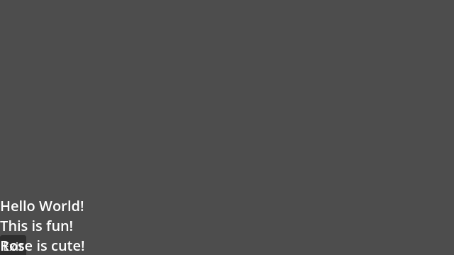
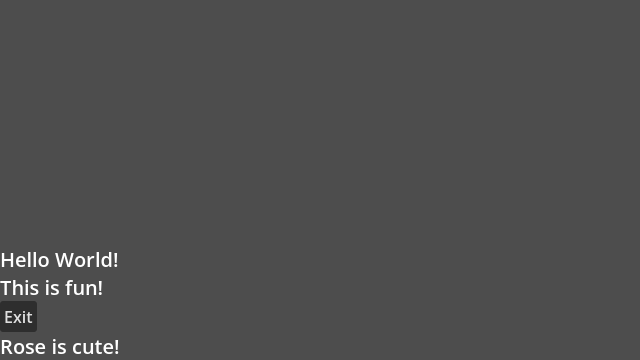
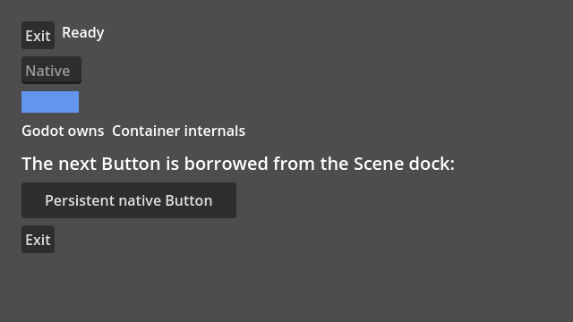
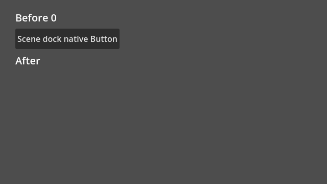

# L04 #145 — native Control minimums and Box rectangles

Issue [#145](https://github.com/papercraftgames/Estragon/issues/145), branch `codex/l04-native-controls`, base/main **`7ddaeb18a073b13b1ff644a997971c9a1420501f`** (E11 PR#149 merged). Clean native-tested source **`900a141331be7e9166f78bf1a876555710f5564a`**; subsequent changes record documentation/evidence only. Live issue/sole PR controls review/merge. This is focused local acceptance, not release certification.

## Result and developer contract

Before L04, a native Godot Button had no layout participant, so the owner's nested Settings HBox contributed no footprint. The baseline on main rendered Exit and Rose at the same y332. The bridge measures native combined minimums and allocates native outer rectangles through the existing coordinator/core. Both approved engines now report:

| Item | Global position | Native allocation |
| --- | --- | --- |
| Hello World! | (0,245) | (119,28) |
| This is fun! | (0,273) | (104,28) |
| Native Exit | (0,301) | (37,31), equal to native minimum |
| Rose is cute! | (0,332) | (120,28) |







`Button` remains the real Godot class with no attached Script or metadata; `UiButton` remains EstragonButton. An external weak-host adapter retains native subscriptions, measures `get_combined_minimum_size()` and defers/coalesces changes. Position/size assignments compare the allocated rect and suppress their own native resize feedback. Only compatible2D children/root views acquire adapters. Native Containers are opaque outer participants; Godot exclusively sorts their internal Controls. No wrapper/helper Node, user fields/metadata, cloning/reparenting, polling or additional renderer/reconciler is introduced.

The pure core gains a zero-default allocation floor. Native flex minimums reserve space before sharing the remainder; existing zero-floor participants keep equal sharing. Under genuinely insufficient fixed outer space, native minimums are preserved and content can overflow sequentially. Native arranged size never becomes intrinsic input. [Developer comparison, flags/zero minimums, position/anchor/pivot/transform/canvas authority, focus ancestry and runnable snippets](../NODE_UI.md#l04--native-control-auto-layout), [scene-owned Control contract](../SCENE_CHILDREN.md#native-controls-l04).

## Final clean installed acceptance

Official Linux4.0.4 (`fc0b241c9`) and pinned4.7.0 (`5b4e0cb0f`) each pass:

- **57 runtime checks**, actual native Exit input→`SceneTree.quit()`, and **3 runnable-example checks**.
- **20 real editor checks +4 after process restart**: native scene ownership/UndoRedo/save, both rendered main/current Play paths, unsaved dependency save, invalid source rejection and transactional bytes/maps/timestamp/Script identity/UID preservation, repair and re-open.
- Direct Yarn package use from `res://node_modules/@papercraftgames/estragon/`; no copying/symlink/ignore workaround. Installed bytes/all **56 addon UIDs** unchanged.

Both use the identical reproducible development tar SHA-256 **`a54c6a571c95379f5119a2348294e5f2a9f0f012cb543d5c95ef178b4888b5a9`**. [4.0.4 results](l04/4.0.4/results.json), [4.7 results](l04/4.7/results.json), adjacent provenance/logs/consumer audits and package manifests retain exact commands, elapsed stages, source and engine hashes. Expanded editor stages are bounded at120 seconds, separate from the unchanged routine CI60-second total budget.4.0.4 editor/restart took66.53/28.38s. Only the established native build-callback error is allowed during deliberate invalid-source Play rejection; no native error/leak exemption was introduced.

Runtime checks cover Button/Label/LineEdit/TextureRect and native HBoxContainer internals; natural minimum/text/texture/theme/font/custom minimum; natural versus explicit EXPAND_FILL, fixed/flex allocation, hidden children/root, viewport resize and nested branch insertion/removal/keyed reorder. Native text changes leave Gogo run counts and unchanged sibling measurements cached. Batched native signals cause one measured refresh; idle minimum-read/measure/arrange/flush counters remain unchanged. No per-frame process is added.

Native input proof sends real Viewport mouse/key events: one click→one signal, disabled suppression, focused Space activation, native Tab via authored focus links and LineEdit text input. Native Controls under different Node2D parents can be separate native GUI roots; automatic cross-root Tab order is not promised. Native `focus_next`/`focus_previous` links work and remain untouched. The custom Estragon pointer router does not synthesize native Control events.

Borrowing checks persistent exact parent/owner/instance/signal identity, translated Box placement, plain Sprite free positioning, external rect correction, repeated/reordered projection, release rect restoration/bridge disconnection without freeing the Control, re-entry, native reparent, free and pack/reload with no transient output. Native editor addition/deletion UndoRedo retains the exact authored Control/owner/minimum and manual editor rect. Main/current child games prove one native click and nonoverlapping borrowed slots. Saved scenes contain only the authored host/Control; native runtime packing additionally preserves its Sprite.



Boundaries prove anchors/top_level/local transform exclusions without mutation, repair through native invalidation, shared transformed ancestors, empty native minimum and a3D pixel/world-unit boundary. Different viewport/canvas/bases and native Container parent have explicit guard paths; no general global-transform observer or universal geometry is claimed. Custom intrinsic data without a native signal requires `update_minimum_size()`. Native4.0.4 isolated preflight/link introspection remains unavailable/BLOCKED; mandatory actual-path validation/rollback is still enforced.

## Proportional existing checks

At clean `de405b7` (identical production addon bytes to final native-tested head), approved4.7 only:

| Existing suite | Result |
| --- | --- |
| Native core/runtime |18 core +147 runtime; editor persistence passes and2D/3D graphics PASS |
| Composition |49 runtime +42 editor; build/import/graphics/rollback PASS |
| L03 nested host layout |37 runtime + native Exit quit PASS |
| E08 borrowed scene projection |36 runtime +4 rejection/repair PASS |

[Exact regression logs/results/provenance](l04/regression-4.7). Composition used container-local output to avoid Docker host-mount chmod restrictions, then copied evidence out. No full73 or all-minor matrix was run. [Frozen install/typechecking/policy30](l04/static.txt) PASS; [161 canonical script UID sidecars](l04/uids.txt) valid, unique and paired, with explicitly archival research excluded. New UIDs were created at their canonical paths in an isolated native4.7 import; no arbitrary runner UID was copied. Generated example code/maps/UIDs agree with source.

## Corrected development failures and limitations

Development failures are not counted as acceptance: fixture native Button initially used framework-only properties; an unsupported public parent-item getter was replaced by native local/global matrices; early child-exit reacquisition was blocked through a deferred weak tombstone; first allocation now captures the rect after native add initialization. Later proofs caught hidden native-root proxy minimums and Control projection position bookkeeping. Strict cold weakref inference, a4.0 example Array inference and an old regression callback reference were corrected. An expanded4.0 editor session reached the original60-second focused timeout after passing rollback and UndoRedo; its finished120-second-bounded run above passes. The initial composition collector failed only on Docker host-mount chmod; its container-local run passes. These do not change routine CI, native failure policy or engine support.

Before/after, editor/game and gallery captures were inspected. **Manual interactive/macOS smoke was not run.** No other engines/platforms, physical-key gate, exhaustive73-stage suite, package publication/registry/release certification, release/tag/version/workflow changes, Assets changes or merge. Broader Box#55/percent#54/position#88/naming#146 remain separate. E11 upstream gutter and exploratory#148 leak evidence retain their original scope/verdict.

## Reproduction and retained evidence

Owner-approved Docker `estragon-e04-local`, image `estragon-p02-linux-env:local`; read-only repository `/repo`, authenticated engines `/engines`, writable host `/tmp/e04-local` at `/evidence`. Xvfb/Openbox/Mesa software graphics; isolated self-contained native editor settings, empty compiler-tool PATH. The user's checkout plugin preferences were never changed. Final raw output `/tmp/e04-local/l04-review3`; baseline `/tmp/l04-before3.log` with staged unmodified-main addon, corrected development package `/tmp/e04-local/l04-dev-installed2`. [Artifact SHA-256 index](l04/artifact-index.json); archived logs normalize trailing whitespace and use `.txt` in place of `.log`, without altering recorded raw commands.

```sh
bun install --frozen-lockfile
bun run check
docker exec -w /tmp -e XDG_RUNTIME_DIR=/tmp/e04-runtime estragon-e04-local \
  xvfb-run -a sh -c 'openbox >/tmp/l04-openbox-review3.log 2>&1 & exec corepack yarn@1.22.22 node --experimental-strip-types /repo/tools/check-native-controls.ts --editor --engine 4.0.4=/engines/godot-verified-4.0.4/Godot_v4.0.4-stable_linux.x86_64 --engine 4.7=/engines/godot-verified-4.7/Godot_v4.7-stable_linux.x86_64 --output /evidence/l04-review3'
```

Existing regression commands are retained in adjacent provenance/results. `check-native-addon.ts --suites=runtime,composition` first passed runtime but hit the host collector restriction in composition; the successful replacement is `check-composition.ts --engine 4.7=… --output /tmp/l04-composition` within the container. Existing `check-nested-layout.ts` and `check-scene-projection.ts` use the same4.7 engine, distinct output directories and their default focused runtime modes, without `--editor`. Final PR/CI/head/base and owner-review handoff are recorded durably on the live issue/PR; this work is not Done until owner merge.
