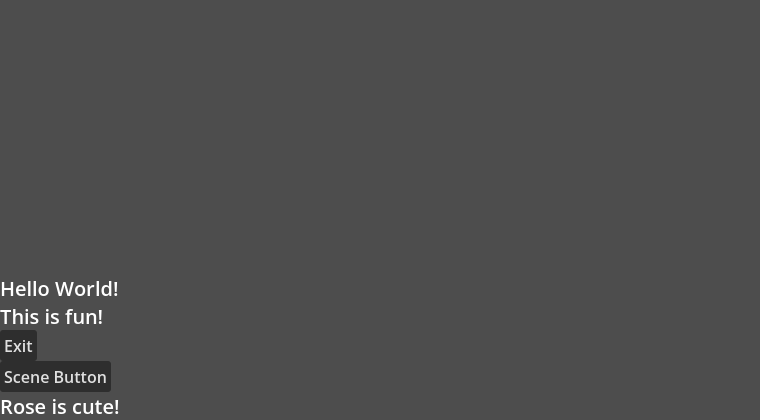

# L05 #151 — independent live viewport axes

Issue [#151](https://github.com/papercraftgames/Estragon/issues/151), branch `codex/l05-viewport-height`, base/main **`5eaf7ed7a45bcc9f4c67d61448ca0ca50ea608c7`** (L04 PR#150 merged). Runtime/full installed proof uses clean **`392508963fad653b116c134ebd02f46b4e08a803`**. Final typed-property completion/editor proof uses clean **`d099baa0b493cfab98d13588e2f630289686418d`**; native runtime, example and runtime/build fixture bytes are identical between these heads. Subsequent changes record documentation/evidence only. Live issue/sole PR controls owner review/merge; this is focused local proof, not release certification.

## Visible result and API

The owner's static `width={get_viewport_rect().size.x}` / `height={...y}` expressions are snapshots when a Gogo function composes. The snapshot fixture preserves those expressions, starting at1152×648 and growing to1800×1100. Its root remains1152×648 and Rose's bottom stays648. Replacing them with `viewport_width_scale={1.0}` and `viewport_height_scale={1.0}` produces live1800×1100 allocation and Rose's bottom1100, without application resize handlers or recomposition. Both official Linux engines agree. This comparison reproduces the reported static-expression behavior using the installed task package; it is an API-adoption comparison rather than a separate old-addon certification.




Native Entries now export `viewport_height_scale` beside existing width, with the same finite/nonnegative validation, equal-write no-op and default0 disabled semantics. The shared internal scale hook returns a Vector2; the existing native viewport signal/deferred flush overrides each selected axis from the visible rect. Positive scales override fixed width/height on that axis; zero returns to current fixed/natural data. Existing proof-mode width consumers still work. No core math, layout/reconciler/renderer, per-frame polling or general expression-observation system was added.3D scales are explicitly chosen world units per visible viewport pixel; Z remains fixed/natural.

The existing metadata completion path displays known GGX property types, including **`viewport_height_scale — float`**, while insertion remains the plain native property name. Ordinary GDScript/method/signal/tag completion behavior is unchanged by that one-line presentation rule. Native Inspector metadata is float/exported; unknown attributes and quoted non-string values still reject with authored diagnostics/maps preservation. [Authoring/precedence reference](../NODE_UI.md#l05--follow-both-viewport-dimensions), [native runtime API](../NODE_RUNTIME.md). Runnable [NativeHome.gogo](../../examples/nested_layout/NativeHome.gogo)/[scene](../../examples/nested_layout/NativeHome.tscn) now use live scales; its generated code/map and original stable UID are committed. The separate GogoDemo repository was not modified.

## Native and direct-Yarn acceptance

| Official Linux engine | Runtime / wall | Native Exit | Editor / restart |
| --- | --- | --- | --- |
|4.0.4 (`fc0b241c9`) | **50 PASS**,6.55s | Actual GUI→quit PASS |5/2 PASS,23.16/19.96s |
| pinned4.7.0 (`5b4e0cb0f`) | **50 PASS**,8.42s | Actual GUI→quit PASS |5/2 PASS,28.52/17.78s |

[4.0.4 results](l05/runtime/4.0.4/results.json), [4.7 results](l05/runtime/4.7/results.json). Both use identical reproducible development tar SHA-256 **`4e694f1a34b2d8d7a2fa1ecef9ae24621e2c62d8b6503441cc16bd36ef6e1a18`**, installed directly under `res://node_modules/@papercraftgames/estragon/`. Installed bytes and all **56 addon UIDs** remain unchanged. No copying/symlink/package-ignore workaround. Adjacent consumer audits, package manifests and provenance retain exact commands, immutable source and original engine hashes.

The50 runtime checks cover:

- Original four-row snapshot/live rendered geometry,1152×648→1800×1100→760×420 X/Y allocations, bottom flow and native Exit. Additional scene-owned Button proves borrowed placement and exact parent/owner/identity. Nested Settings/Rose/native Button Script/Node identities survive resizing.
- Native GUI click, borrowed native signals and UiButton pointer input each fire once. Gogo Home/Settings run counters remain unchanged; clean Rose measurement stays cached. Idle stats remain unchanged and synchronous native SubViewport resize bursts coalesce to one deferred flush.
- Width-only, height-only, neither, unequal fractions, positive-scale precedence over fixed axes,0→positive→0, natural-size restoration, invalid negative/NAN/INF/-INF and unchanged writes. Zero/near-zero requests follow Godot's actual visible-rect minimum clamp.
-2D/3D own SubViewport subscriptions, detach disconnection, re-entry into a new viewport with exactly one listener, stale viewport isolation and nested independent Entries. Real Gogo Entry3D uses explicit0.01/0.02 scales with depth7. Native viewport2D override/stretch follows visible coordinates rather than raw render-target size.
- Exported float Inspector metadata, misspelled attribute rejection with valid generated bytes/maps/Script identity preserved, authored typed-expression diagnostic and repair through mandatory actual-path compilation. All external layout/composition/Control records are empty after teardown.

4.0.4 isolated preflight and symlink introspection remain unavailable/BLOCKED; actual-path validation/rollback stays mandatory. No extra engine/platform or unsupported-minor claim is made.

## Final typed editor completion follow-up

After the full run, the final editor-only change adds the type label using existing member metadata. Only editor/build/Play/restart proof was repeated; unchanged runtime assertions were not rerun. Native/runtime fixture bytes match the full tested head. Each fresh direct-Yarn editor consumer passes **5 editor +2 restart checks**, including actual CodeEdit float label/plain insert text and unchanged authored source, installed build/maps, current/main resized child games, one native GUI callback, persistent scene ownership and independent editor restart.

| Engine | Editor / restart wall |
| --- | --- |
|4.0.4 |33.11 /22.65s |
|4.7.0 |29.05 /18.26s |

[Final4.0.4 results](l05/editor/4.0.4/results.json), [4.7 results](l05/editor/4.7/results.json). Both use identical final reproducible development tar **`9ccff43936a6255025a0e71382e3ec504b0d6222fd8e6849fabea941bb31e0a3`** and preserve all56 addon UID/installed bytes. The only package-file change from the runtime phase is the completion display line; manifests preserve exact phase-specific identity. No tested tar was patched afterward. All native stages reject every unexpected error/leak; this runner has no negative-error allowance. Game proof JSON is parsed/cached before use and published atomically after close.


## Proportional regression and static checks

Existing approved4.7 native runtime regression at clean **`3dcc910226e2a1c049a3b1b8ea099cce9af4dc45`** (identical final runtime source): **18 core +147 runtime**, both native editor persistence passes and rendered2D/3D provider/lifecycle captures **PASS**,35.76s total. [Exact results/logs/provenance](l05/regression-4.7/results.json). This also preserves previous width/proof-mode behavior. No full73/composition/editor UX matrix was demanded.

`bun install --frozen-lockfile && bun run check`: typechecking and **30 policy tests PASS** ([log](l05/static.txt)). **164** canonical committed Script UID sidecars are valid, unique and paired, explicitly archival research excluded ([audit](l05/uids.txt)). New fixture UIDs were generated by native4.7 at their canonical paths in an isolated project; the example UID remains unchanged. Source maps and source-generated example agreement pass existing policy. Scope/diff audits find no Assets, release/version/tag/workflow/package metadata or owner-demo changes.

## Corrected development attempts and untested items

Earlier attempts are not final acceptance.3D expectations initially used exact float comparison for0.9/0.45; approximate comparisons correctly match native Vector3 precision. A source-error assertion initially expected the property name, while the native compiler correctly emitted its established typed-expression diagnostic with authored line/column; the proof now checks that actual contract. The first editor fixture queried the source association before ready. A later truncating buffer probe during initial indexing hit native4.0 coroutine-resume/disconnect errors despite functional geometry checks. The fixture now settles native filesystem/build and places a caret in unchanged valid source. Subsequent full and typed-editor-only runs above are clean on both; no production workaround or error exemption was added for those harness failures. No claim is made to diagnose/fix a general native coroutine bug.

Before/after, small/large and final editor/game captures were inspected. **Manual interactive/macOS Godot4.7 smoke was not run**; no physical-key gate is required. Other engines/platforms, exhaustive73-stage suite, release certification/registry/publication are unrun. Parent percentages#129, Box#55, broader positions#88 and naming#146 remain separate. No automatic user expression reactivity or px-to-world policy was introduced. PR is In review until owner merge; never auto-merge.

## Reproduction and provenance

Owner-approved Docker `estragon-e04-local`, image `estragon-p02-linux-env:local`; read-only repository `/repo` and authenticated engines `/engines`, host `/tmp/e04-local` mounted at `/evidence`. Xvfb/Openbox/Mesa software graphics, isolated self-contained settings and empty compiler-tool PATH. No addon preference was enabled in the shared checkout. Raw final runtime/full output `l05-final2`; final UI follow-up `l05-editor-final`; native regression `/tmp/l05-runtime-regression` inside Docker then copied out. [Artifact SHA-256 index](l05/artifact-index.json). Archived logs normalize trailing whitespace and use `.txt` instead of `.log`; recorded commands remain exact.

```sh
bun install --frozen-lockfile
bun run check
docker exec -w /tmp -e XDG_RUNTIME_DIR=/tmp/e04-runtime estragon-e04-local \
  xvfb-run -a sh -c 'openbox >/tmp/l05-final2-openbox.log 2>&1 & exec corepack yarn@1.22.22 node --experimental-strip-types /repo/tools/check-viewport-layout.ts --editor --engine 4.0.4=/engines/godot-verified-4.0.4/Godot_v4.0.4-stable_linux.x86_64 --engine 4.7=/engines/godot-verified-4.7/Godot_v4.7-stable_linux.x86_64 --output /evidence/l05-final2'
docker exec -w /tmp -e XDG_RUNTIME_DIR=/tmp/e04-runtime estragon-e04-local \
  xvfb-run -a sh -c 'openbox >/tmp/l05-editor-final-openbox.log 2>&1 & exec corepack yarn@1.22.22 node --experimental-strip-types /repo/tools/check-viewport-layout.ts --editor-only --engine 4.0.4=/engines/godot-verified-4.0.4/Godot_v4.0.4-stable_linux.x86_64 --engine 4.7=/engines/godot-verified-4.7/Godot_v4.7-stable_linux.x86_64 --output /evidence/l05-editor-final'
```

The existing regression command is `check-node-runtime.ts --graphics --engine 4.7=… --output /tmp/l05-runtime-regression` through the same container/Yarn/Xvfb entry point; complete absolute command is in its provenance. The live issue/sole PR handoff records final head/base, routine CI wall/queue and owner-review next action. No extra push/CI rerun is needed just to record those remote results.
