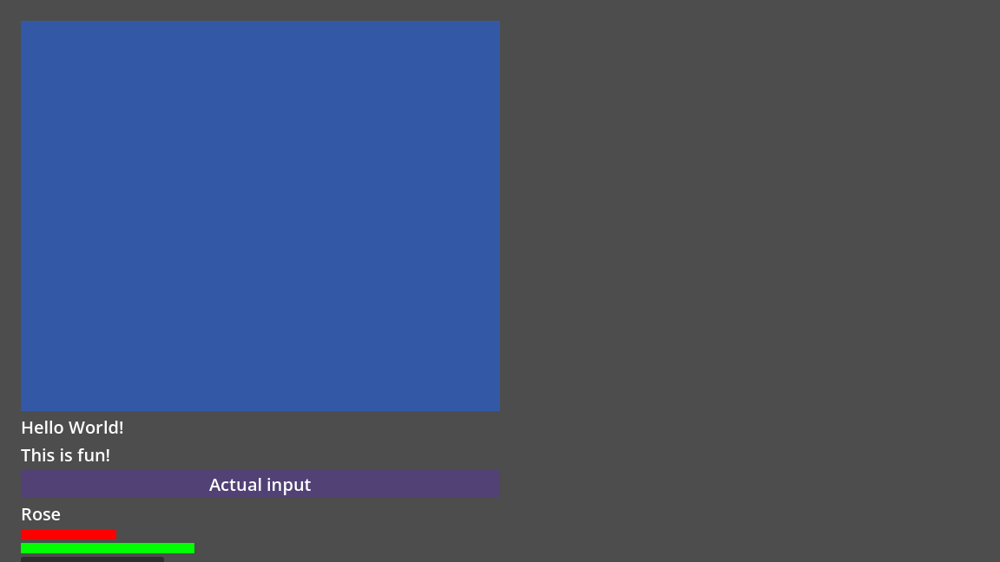

# L06 — retained numeric/unit-string lengths

Issue [#156](https://github.com/papercraftgames/Estragon/issues/156), branch
`codex/l06-unit-lengths`, base `a2cd5e4` (merged #154). This is an intentional
beta API replacement. [Current contract and migration](../LENGTHS.md).
Implementation/testing is complete locally at **`7a5f7e9c6812d8370b4733ea666bbe2b41983e6f`**;
owner review/merge remains separate. Later evidence/status commits do not alter
runtime/compiler/editor/fixture bytes. No release certification or publication.

## Final native acceptance

Only official Linux **4.0.4.stable.official.fc0b241c9** and pinned
**4.7.stable.official.5b4e0cb0f** were launched. Each fresh direct-Yarn consumer
loads the package inside node_modules without copies, symlinks or ignores. Both
used identical reproducible development tar SHA-256
**`0624d6b2c6b683b8b84f1808cc36387e8f7dee1aabe0bba326f6509e2face273`**.
All **59 installed addon Script UIDs and every installed byte remain unchanged**.
[4.0.4 provenance](l06/acceptance/4.0.4/provenance.json),
[4.7 provenance](l06/acceptance/4.7/provenance.json),
[package manifest](l06/acceptance/4.7/package-manifest.json),
[consumer integrity](l06/acceptance/4.7/consumer.json).

| Engine | Runtime | Native invalid writes | Editor / restart | Build / runtime / editor / restart wall seconds |
| --- | --- | --- | --- | --- |
| 4.0.4 | 111 PASS | 5 exact expected diagnostics; retained specs PASS | 10 / 6 PASS | 2.38 / 12.45 / 27.77 / 21.10 |
| 4.7 | 111 PASS | 5 exact expected diagnostics; retained specs PASS | 10 / 6 PASS | 1.60 / 6.88 / 20.43 / 13.51 |

[4.0.4 results](l06/acceptance/4.0.4/results.json),
[4.7 results](l06/acceptance/4.7/results.json). Whole two-engine runner119.71s;
focused local graphics/editor work is separate from routine CI's60-second budget.
The rejection runner accepts only the five exact width-domain errors within
stderr markers; all other errors/leaks fail. The runtime's documented root
percentage warning and native overflow-exponent warning are retained. On4.0.4,
optional isolated preflight/symlink introspection remains unavailable/BLOCKED;
mandatory transactional actual-path validation and rollback pass.

The source-authored Home has the owner's inline VBox50%/75%, Hello/This-is-fun,
Settings/Rose shape, plus visible Rect geometry and retained/keyed/borrowed test
children. No extra Gogo host or helper is needed to size the inline VBox.
Three actual content/geometry traces are identical on both engines:

| Visible Viewport | Parent content | Inline border box | Native origin |
| --- | --- | --- | --- |
| 1152×648 | 1104×600 | 552×450 | 24,24 |
| 1440×900 | 1392×852 | 696×639 | 24,24 |
| 800×500 | 752×452 | 376×339 | 24,24 |

[Geometry traces](l06/acceptance/4.7/geometry.json),
[real current/main game traces](l06/acceptance/4.7/l06-game.json.txt).
Parent padding is subtracted once. Additional native tests prove axis-aware
percentage margins/gaps, explicit-edge precedence, negative additive offsets,
x50%, overflow125%, weighted flex2:1, explicit cross stretch and native packing/
reparent. Unit-family fixtures compile every dimension/offset/inset spelling and
load the generated scripts. Invalid units/signs/auto/types/NAN/INF preserve actual
Script identity/bytes/maps; repair succeeds. Dynamic descendant preflight rejects
before allocation/property/tree mutation and identifies the source/property.



[1440×900](l06/acceptance/4.7/owner-1440.png),
[800×500](l06/acceptance/4.7/owner-800.png),
[visible borrowed native Button input](l06/acceptance/4.7/native-input.png),
[negative offset](l06/acceptance/4.7/offset-negative.png),
[x50% offset](l06/acceptance/4.7/offset-percent.png),
[separate bottom-flex proof](l06/acceptance/4.7/flex-bottom.png),
[native Inspector field](l06/acceptance/4.7/inspector.png),
[actual editor game](l06/acceptance/4.7/editor-game.png).
Captures were inspected against numerical geometry and actual input assertions.
At the smallest viewport, the exact owner shape and extra test rows intentionally
overflow: percentage height does not shrink to accommodate siblings. Native
borrowed GUI input is tested separately at1152×1200 with an asserted visible
rect. Native4.7 correctly rejects clicks outside the viewport.

Viewport changes retain native/Gogo/Script/key/scene-child identity and never
recompose a view. Fixed siblings record zero new parse/resolve/measure work.
Idle frames add no parsing/resolution/layout/recomposition/scans. SubViewport,
detach/re-entry and explicit3D100px/world-unit conversion/Z offsets pass. Native
Control GUI and UiButton pointer callbacks each dispatch once. The editor uses
actual CodeEdit completion and unsaved current-Play saving, native Inspector
string entry/rejection/undo/redo, both Play paths and a fresh editor restart.
The permanent multilevel Gogo regression also proves a600×400 flex panel with300×200 percentage descendants, resizing to600×600 /300×300 with retained identity. No physical keypress or manual interaction claim is made.

## Focused regressions, migration and audits

- At final source7a5f7e9, existing Box/Counter direct-Yarn runtime **68 PASS** on
  pinned4.7: pure core/insets/overflow/margins, clean sibling cache, intrinsic
  invalidation, packing, actual Counter input/reactivity and source rollback/
  repair. [Results](l06/box-regression/4.7/results.json).
- At pre-flex-correction source633beea, existing composition **49 runtime +42 real editor
  assertions PASS**, plus import/rendered capture.77.38s editor/92.96s whole
  runner. [Results](l06/composition-regression/4.7/results.json). This verifies
  the sole observation manager after deleting the old helper context stack.
- Earlier development source/provenance retained: existing core **18** and native
  runtime **149 PASS** on pinned4.7; [results](l06/core-development/4.7/results.json).
  This is explicitly development evidence, not relabeled final-source proof.
- `bun install --frozen-lockfile` and `bun run check`: typecheck +**30 policy tests
  PASS**. [Log](l06/static.txt). **174** live canonical Script UIDs paired/unique,
  with no orphan sidecars; [audit](l06/uids.txt). Deleted helper/contract Scripts
  and obsolete fixtures were paired with their UIDs; moved example UIDs remain.
- Removed public helper/catalog/export, fill booleans and viewport-scale fields,
  old host observation context and unused geometry signals. All live consumers
  and checked-in generated GDScript/maps migrate. Old attrs occur only in explicit
  negative diagnostics/migration/history; no executable compatibility aliases.
 29 source/generated maps match their authored content and declared code hashes. The routine native smoke also passes ([results](l06/routine-smoke/routine-smoke.json),1.39s whole runner).
  [Native example regeneration](l06/example-build.txt). Supplied Assets,
  dependency/version metadata, workflows and release/publication controls stay
  unchanged. The former helper and viewport runners are replaced by L06.

## Failed development/acceptance attempts and limitations

Earlier attempts remain [separately archived](l06/earlier-attempts), never called
PASS for the entire run:

1. Native rejection markers originally used stdout while engine errors used
   stderr. Pipe ordering moved markers ahead of the expected errors. The harness
   rejected this; markers now share stderr, with the strict diagnostic allowlist.
2. A generated in-memory unit fixture lacked its matching resource directory,
   producing invalid gdscript:// relative preloads. An intermediate same-path
   fixture also collided with native4.0 script cache identity. Unique Script
   paths in the actual generated directory fix the fixture; no compiler fallback.
3. On the next run4.0.4 runtime/editor/restart passed;4.7 failed only an attempted
   borrowed GUI click below the viewport in the intentionally overflowing small
   layout. The final separate tall input fixture asserts visibility first.
4. The original Box regression retained old expectations that numeric strings
   were invalid and invalid native writes were silent. It failed explicitly.
   Migrate those expectations; the new standalone rejection proof covers actual
   error-and-retain semantics. Final Box68 passes.
5. One ad-hoc development copy was truncated by the host/container filesystem
   while files were being edited, resulting in silent4.0 script-load failure;
   the4.7 diagnostic identified the truncated call. Recopy with matching SHA-256
   fixed that development fixture. Final consumers are from clean committed
   sources, packaged/installed with byte and UID integrity checks.

During development, directly inspecting an inherited relative-path globally named
Estragon2D on pinned4.7 emitted native `Class name cannot be empty` while its unit
fields and undo/redo still worked. [Retained failed probe](l06/development/l06-editor-dev.txt).
The engine's global-class cache had an empty native base for relative-path
inheritance; its icon lookup takes that empty cache value. The relevant pinned
[global-class source](https://github.com/godotengine/godot/blob/5b4e0cb0f/modules/gdscript/gdscript.cpp#L2717)
and [icon lookup](https://github.com/godotengine/godot/blob/5b4e0cb0f/editor/editor_node.cpp#L5752)
explain this inference. No private cache repair, mandatory global-name inheritance,
icon asset or new engine requirement was introduced. **This inherited-class icon
limitation is not fixed/PASS.** Final native Inspector acceptance uses the direct
Node2D participant base on both engines. It proves public union editing/storage/
undo, without claiming the separate inherited-class icon issue fixed.

Manual interactive/macOS smoke, other engines/platforms, full73, universal Control
units, font-relative units, calc/absolute positioning, release certification,
registry/publishing and owner merge were **not run/implemented**. Broader native
GUI/physics/transform policies remain Godot-owned; no arbitrary geometry solver.

## Exact local commands

Owner-authorized Docker `estragon-e04-local`, image `estragon-p02-linux-env:local`;
read-only repository `/repo`, authenticated engines `/engines`, host
`/tmp/e04-local` at `/evidence`. Native settings/PATH are isolated. Openbox/Xvfb/
Mesa software graphics. No shared checkout plugin/preferences are changed.

```sh
docker exec -w /tmp -e XDG_RUNTIME_DIR=/tmp/e04-runtime estragon-e04-local xvfb-run -a sh -c 'openbox >/tmp/l06-final-flex2-openbox.log 2>&1 & exec corepack yarn@1.22.22 node --experimental-strip-types /repo/tools/check-lengths.ts --editor --engine 4.0.4=/engines/godot-verified-4.0.4/Godot_v4.0.4-stable_linux.x86_64 --engine 4.7=/engines/godot-verified-4.7/Godot_v4.7-stable_linux.x86_64 --output /evidence/l06-final-flex2'
```

Through the same Xvfb/Yarn entry point, `tools/check-box-model.ts --engine 4.7=…
--output /evidence/l06-box-flex2-final` and `tools/check-composition.ts --engine 4.7=…
--output /tmp/l06-composition-regression` produced the final regressions.
Development `tools/check-node-runtime.ts --runtime-only --engine 4.7=… --output
/evidence/l06-core-dev3` retains its original source/dirty provenance. Exact full
stage commands, engine hashes, actual statuses/timings and original temporary
paths are retained in each results/provenance file. Logs are archived as `.txt`
with trailing whitespace trimmed; JSON keeps original `.log` names. No certified
artifact was patched. [Artifact SHA-256 index](l06/artifact-index.json).

Final source review found a multilevel Gogo/flex regression after the initial complete phase at633beea ([retained original phase](l06/initial-complete/4.7/results.json)). A600×400 panel incorrectly gave its percentage child300×0 because the transparent host's internal X-axis convention reinterpreted vertical flex authority. The correction forwards explicit independently allocated axes and reads deep proxy constraints after managed-child measurement. The final permanent regression verifies300×200 then300×300 with retained identity. Unanchored warnings now occur only at final arrangement, not provisional measure. [Minimal reproduction](l06/development/deep-flex-repro.gd.txt), [focused development repair](l06/development/deep-flex-runtime.txt). Final111 plus editor/restart evidence above is from corrected source7a5f7e9; the earlier complete phase and pre-correction regressions retain their actual source/tar identities.
