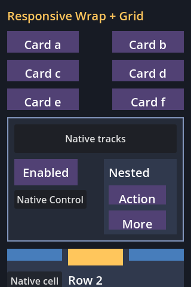
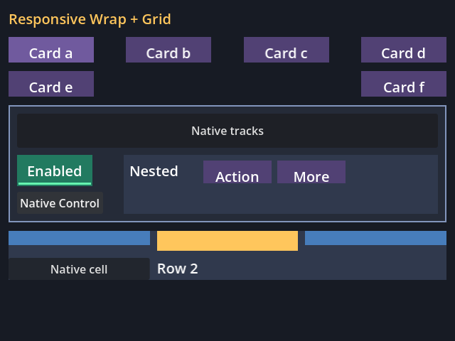
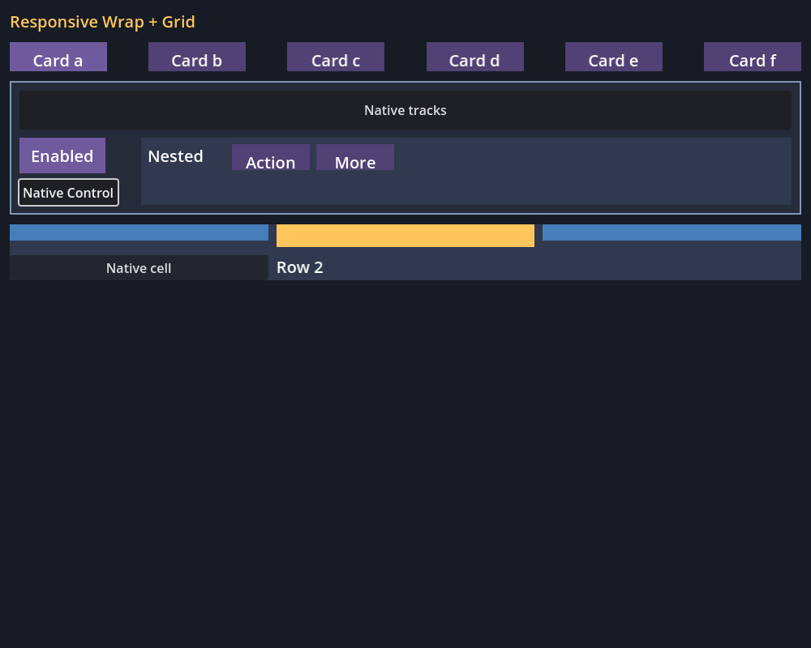

# L09-10 — responsive Wrap and native Grid

[#176](https://github.com/papercraftgames/Estragon/issues/176), base owner-merged
L08 #175 `b2cf0e51958f9517b67743b27fd535bf5254e3a7`. One combined milestone,
superseding separate #162/#163 implementation plans. [Contract](../RESPONSIVE_LAYOUT.md),
[ADR-0025](../DECISIONS.md#adr-0025--combined-responsive-wrap-and-native-grid-slot-strategies).

Wrap and Grid are pure parent-owned slot strategies in the existing mathematical
core. Native Component2D, Length, Control adapters, retained Gogo, transforms,
drawing and input stay common. Grid placement lives on Elements and external
weak records, never foreign Node setters/metadata. Explicit rows are bounded;
implicit rows grow. Native remove/re-entry retains placement; individual free
and subtree destruction clear weak records. See the contract for percentage
references, track floors, spans, overflow, physical gaps and line/cell alignment.

## Exact sources and outcomes

Final addon/complete focused acceptance and seven-stage package source:
`9de6acf43a8ccf329dca6b4dbf6b64401d09a711` (clean). Matching development tar SHA256
`4f7ff59f3c659e7f01e5683a3d658c2c2f511623911c8d1154d00e9367933306`,69 immutable
installed addon UIDs and identical package files on both engines.
[Source qualification](l0910/source-qualification.json) checks four independent
manifests against each other and the current addon checkout. No release/tag/version
or publication action occurred. This is a development package, not release authorization.

| Check | Official Linux4.0.4 | Pinned Linux4.7.0 |
| --- | --- | --- |
| Final pure Wrap/Grid/core numerics | PASS95 | PASS95 |
| Native compiler/completion/actual-path repair | PASS21 | PASS21 |
| Final native runtime/rollback/lifecycle | PASS44 /21 intended errors | PASS44 /21 intended errors |
| Rendered320/640/1000/back640, input and pack/reload | PASS | PASS |
| Real Grid/Wrap Inspector, current+main invalid/repair Play | PASS20 | PASS20 |
| Cold native editor restart/Play | PASS12 | PASS12 |
| Seven-stage actual direct-Yarn package gate | PASS | PASS |
| Strict paired hashed package assessment | PASS | PASS |

Real Inspector/Play/restart was executed at clean
`4846c6315c01401d3ded1809f2b6c26ad61384cc`, separately retained in
[editor evidence](l0910/editor/4.0.4/results.json). Final follow-ups fix weak
placement disposal/re-entry, physical percentage-gap dependencies, strict inferred
local types and diagnostic origins, and narrow the tiny gallery label. They have
final-source two-engine installed runtime/graphics coverage; earlier editor runs
are not relabeled as later-source execution. Both final package gates also pass
24 native runtime and50 real package editor assertions, including native compiler,
Counter/reload/Play/repair and unchanged installed bytes. The final test-only
nested-button hit refinement is separately retained as a focused supplement.

Exact geometry covers transposed Wrap160→230→160 (0/80 then Y32), line distribution
and align_content including0/1/overflow, growth/floors, nested allocated auto height,
Grid320→620 equal tracks,100px/1fr/2fr fractional allocation, explicit-first
row-major spans, template/named equivalence, auto/%/fr floors and asymmetric margins.
Native tests cover keyed/conditional retention, project Gogo area placement,
a native Control area, invalid tracks/config/placement/spreads/anchors/transforms
with whole-tree retention, source-key diagnostics and repair, hidden-child reflow,
font/native minimum changes, quiet unrelated branches/idle/equal updates, owner and
weak-record cleanup. Resizing does not reexecute Gogo. Actual native/Button/Toggle
signals are counted, not inferred from parsing or rectangles.

Pinned4.7 proportional regressions PASS: shared core18/runtime149 including3D;
L08 math112/frontend25/rejections54/runtime35; lengths/L07/L11 runtime243/exact24
intended diagnostics/native root Exit; S03 frontend61/publication7/rejections93/
runtime28; S01/S02 styling158/exact21 intended diagnostics; native Controls57/
Exit/examples3; Counter/native UI32; tiny routine smoke. Frozen install/typecheck/
policy30 PASS.230 unique paired native script UIDs and both canonical responsive
source/output maps pass. New UIDs/maps came from the native canonical-path import,
not temporary runner UID copies. These are scoped regressions, not a full73 run.

## Commands and provenance

All Godot execution is official Linux4.0.4/pinned4.7.0 under isolated settings,
Docker `estragon-e04-local`, Xvfb/software graphics (Openbox for editor games).
The workspace is read-only `/repo`; evidence is writable `/evidence`. Engine
identity/SHA256 is verified by existing tooling against the approved manifest.
No Python or external compiler/runtime toolchain is introduced.

```sh
bun install --frozen-lockfile
bun run check
# At clean4846c63; full combined editor acceptance, not repeated after each edit:
corepack yarn@1.22.22 node --experimental-strip-types /repo/tools/check-responsive.ts --editor --engine 4.0.4=/evidence/s03-engines/godot-verified-4.0.4/Godot_v4.0.4-stable_linux.x86_64 --engine 4.7=/evidence/s03-engines/godot-verified-4.7/Godot_v4.7-stable_linux.x86_64 --output /evidence/176-review-2
# At clean9de6acf; final focused changed scope:
corepack yarn@1.22.22 node --experimental-strip-types /repo/tools/check-responsive.ts --engine 4.0.4=/evidence/s03-engines/godot-verified-4.0.4/Godot_v4.0.4-stable_linux.x86_64 --engine 4.7=/evidence/s03-engines/godot-verified-4.7/Godot_v4.7-stable_linux.x86_64 --output /evidence/176-final-focused-2
corepack yarn@1.22.22 node --experimental-strip-types /repo/tools/check-native-addon.ts --fast-release --engine 4.0.4=/evidence/s03-engines/godot-verified-4.0.4/Godot_v4.0.4-stable_linux.x86_64 --engine 4.7=/evidence/s03-engines/godot-verified-4.7/Godot_v4.7-stable_linux.x86_64 --output /tmp/176-package-final-2
corepack yarn@1.22.22 node --experimental-strip-types /repo/tools/assert-release.ts /tmp/176-package-final-2/4.0.4/addon-evidence.json /tmp/176-package-final-2/4.7/addon-evidence.json
```

Each archived results/provenance file records exact native commands, hashes,
source SHA, settings and output paths. Regression commands are in their own
results/provenance. Original complete raw bundles remain at host
`/tmp/e04-local/176-review-2`, `176-final-focused-2`, `176-package-final-2`;
[archived selection/hash inventory](l0910/artifact-index.json) makes review evidence
durable in GitHub. Log suffixes become `.txt`; bytes remain unchanged. Package
assessments were run against the complete raw bundles before selecting the archive.
The archive does not pretend missing original stage paths can be re-assessed in place.

## Render inspection and limits

Inspected both approved engines' final320/640/1000 rendered samples. Six cards
form3/2/1 lines and resize back to2; the named native Control header and sidebar
share Grid tracks with a nested Wrap; automatic cells grow in fractional widths.
At320px the fixed/minimum content extends toward the viewport bottom normally;
no clipping, scrollbars, shrink or glyph wrapping is invented. At640/1000 the
full gallery is visible. Native controls keep their platform/theme focus visuals.





Manual interactive smoke **UNTESTED**; actual editor/game APIs and native Input
ran automatically. No physical F5/F6 requirement. Other engines/platforms/full73/
3D wrapping/text shaping/RTL/accessibility/scroll/clipping/theme/release/publication
remain untested/out of scope.4.0.4 isolated preflight remains **BLOCKED by engine
capability**, with mandatory actual-path semantic validation/rollback/repair PASS.
The separately owner-accepted hidden never-associated tab highlighter limit stays
unchanged. PR review/merge is an owner action; unmerged work is not Done.

## Retained failures and corrections

[Original results/logs](l0910/failures) preserve failures rather than replacing them
with successful reruns:

- First combined4.0.4 run: graphics timeout after successful math/frontend/runtime.
  The temporary RefCounted probe did not retain its coroutine owner; retaining it
  allowed native4.0 rendering. This uncovered stale weak placement IDs after native
  subtree destruction; cleanup by ID fixed the real lifecycle issue. The bounded
  two-engine run then passed all stages.
- Final edge follow-up: strict actual-path4.0.4 build rejected inferred WeakRef/
  Callable locals as warning-as-error. Explicit types fixed it; final installed
  focused and package gates pass. No native gate or diagnostic was weakened.
- A native Counter regression collector hit Docker bind-volume `chmod EACCES`
  while copying generated evidence, after its build passed. The unchanged check
  succeeds with container-local output copied back afterward; original failure retained.
- Development fixture/import-path/inferred-local mistakes, duplicate strategy
  configuration discarding Grid config, and tiny demo text overflow were corrected
  before review; their precise checkpoints are recorded in #176. Pack-policy tests
  correctly rejected new untracked addon files before staging. These were not
  accepted product behavior or waived errors.
