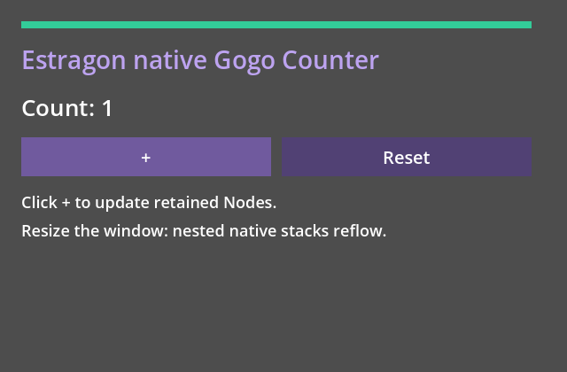

# P05 — package consumer follows L06 spatial units

Issue [#158](https://github.com/papercraftgames/Estragon/issues/158), after merged
L06#157 (`78a5fab`). Tested fixture source **`1585cac8ea6ea47c06d0574f79ca0fd3e8bcb575`**;
subsequent documentation/evidence commits do not change executed fixture bytes.
Only `tests/package-consumer/runtime.gd` changes executable behavior. The parser,
default100 scale, layout math, workflows, release policy and version metadata are
unchanged. The existing runtime.gd.uid is preserved.

## Before and correction

Owner-published beta.16 run [43628105905](https://github.com/papercraftgames/Estragon/actions/runs/43628105905)
stopped before preparation/publishing. Both native jobs built the versioned addon,
then failed `relocated Node3D entry executes shared native layout` in the actual
**direct-Yarn** runtime stage. The old label did not describe its installation.
[4.0.4 excerpt](p05/beta16-40-failure.txt), [4.7 excerpt](p05/beta16-47-failure.txt),
[run/job states](p05/beta16-run.json), [primary source URLs/log hashes](p05/primary-source.json).
No registry publication is inferred from those failed native jobs; preparation,
publish and registry-consumer jobs were skipped in that run.

A native4.0.4 [probe](p05/before-probe.gd.txt) reproduces the exact mismatch:

```text
P05_BEFORE_SET_EXTENT 0
P05_BEFORE_DEFAULT_SCALE 100
P05_BEFORE_ACTUAL (0.03, 0.04, 0.05)
P05_BEFORE_LEGACY_MATCH false
P05_BEFORE_CURRENT_MATCH true
```

[Actual output](p05/before-native.txt). Return0 is Godot `OK`. Under the approved
[L06 contract](../LENGTHS.md), numeric3/4/5 are logical pixels, divided by100.
The old fixture incorrectly expected unscaled world units.

The replacement proves13 spatial assertions: default100 and successful numeric
set_extent, an active independent Entry coordinator/flush, approximate converted
geometry on all axes, retained px-string equivalence, parent percentages over
already-converted world extents, explicit1 migration selected before assignment,
nested independent Entry sizing/native position, updated percentage descendants,
and native free/root-membership/viewport-subscription cleanup. Existing Counter,
pointer/retained identity, typed binding and no-tools checks remain intact.
Each installed runtime now reports **24 assertions, zero failures**:

```text
PACKAGE_SPATIAL_DEFAULT 100 (0.03, 0.04, 0.05)
PACKAGE_SPATIAL_EXPLICIT 1 (3, 4, 5) child=(1.5, 2, 2.5)
PACKAGE_RUNTIME_ASSERTIONS 24 failures=0
PACKAGE_RUNTIME_OK
```

The initial focused fixture exposed4.0's warning-as-error for inferred WeakRefs.
Explicit `WeakRef` declarations fixed only the test; [failure](p05/development-weakref-failure.txt)
and [13-check repair](p05/focused-spatial.txt) remain separate. No native default,
diagnostic exemption or acceptance check was weakened.

## Full unchanged local gate

Official Linux **4.0.4.stable.official.fc0b241c9** (binary SHA-256
`e9a0db9798cf53385693898af39f98d0065552c0808b9e7eb82cfcb0da880ae9`)
and pinned **4.7.stable.official.5b4e0cb0f**
(`f85bbc6b15e22416c7d797cd60b63286dd67b9cb13498847056c18520ae55a75`)
only. The complete unchanged `tools/check-native-addon.ts --fast-release` ran
all seven required stages on clean source1585cac. Both per-engine **and paired**
`tools/assert-release.ts` assessments PASS with no missing/failed stage.

Both tested the same reproducible tar SHA-256
**`0624d6b2c6b683b8b84f1808cc36387e8f7dee1aabe0bba326f6509e2face273`**,
source-content hash
`37d749cdb4fd9588fbdbd29d676095fa31d33db48191311efd9e5d9589d95e9f`.
All **59 addon Script UIDs and every payload byte remain unchanged** after import,
real runtime, cold editor rebuild and rendering. Direct installation uses Yarn's
actual node_modules tree, with no copy, ignore, symlink or canonical fallback.

| Engine | Pack | Install | Build | Import | Runtime | Editor | Visual |
| --- | --- | --- | --- | --- | --- | --- | --- |
| 4.0.4 | PASS10.56s | PASS2.05s | PASS4.72s | PASS26.09s | PASS6.25s /24 | PASS107.98s /50 | PASS4.85s |
| 4.7 | PASS21.31s | PASS4.07s | PASS8.42s | PASS28.02s | PASS8.95s /24 | PASS155.85s /50 | PASS6.53s |

[4.0.4 stage results](p05/fast-release/4.0.4/package/4.0.4/results.json),
[4.7 stage results](p05/fast-release/4.7/package/4.7/results.json),
[paired assessment](p05/paired-assessment.txt). Whole sequential two-engine gate432.56s.
This is scoped local release-equivalent execution, separate from routine CI's60s
budget. The existing negative/error/leak/provenance/hash/UID gates are unchanged.
The editor proves actual cold addon activation, rebuild after deleting generated
executables/maps/cache, real CodeEdit, saved/unsaved main/current Play, malformed
source/missing handler/wrong length/return-contract/unsavable-source rejection,
exact code/map/UID/timestamp/Script-cache rollback and subsequent repair.
Each visual stage checks native increment/reset input and resized rendering.

**Authorization boundary:** these local runs use the supported **development**
overlay (`0.0.0-dev`, null tag/release ID, `estragon-tag-overlay-v1`). This is not
published-tag certification of beta.16, a fabricated GitHub release/dispatch,
registry verification, or permission to publish. The full native stage/hash
assessment gate passes; actual event-bound version materialization and publishing
remain the unchanged owner-triggered workflow's responsibility.

## Additional placement proof

The explicitly requested package-only opt-in suite additionally passes **direct,
relocated (`modules/UI toolkit`) and standard (`addons/estragon`)** on **both**
approved engines. Every layout passes build/import/runtime24/editor50/visual,
preserves installed bytes/UIDs and native ownership, and emits all three required
`PACKAGE_RUNTIME_OK`, `PACKAGE_EDITOR_OK`, `PACKAGE_VISUAL_OK` markers.
[4.0.4 results](p05/layouts/4.0.4/results.json),
[4.7 results](p05/layouts/4.7/results.json),
[per-layout timings, stage inventory and capture comparisons](p05/layout-summary.json).
Whole package-only runs:299.89s4.0.4,266.48s4.7, run independently in isolated
sandboxes. This does not expand routine CI or future release certification into
a mandatory three-layout/full73 suite.

The six direct-gate zero/increment/reset-resized captures were inspected. Every
corresponding additional-layout image is byte-identical to its engine's inspected
direct image (recorded in the layout summary), proving the same actual rendering.



[4.0.4 zero](p05/fast-release/4.0.4/package/4.0.4/direct-package-zero.png),
[4.0.4 resized/reset](p05/fast-release/4.0.4/package/4.0.4/direct-package-reset-resized.png),
[4.7 zero](p05/fast-release/4.7/package/4.7/direct-package-zero.png),
[4.7 resized/reset](p05/fast-release/4.7/package/4.7/direct-package-reset-resized.png).
Headless parsing alone is not called visual proof.

## Audit, static checks and limits

The package/direct/relocated/standard/export/distribution fixture audit found no
other live removed fill/viewport/Pixels APIs or stale numeric3D expectation in
those consumers. Distributed3D examples already deliberately select scale1;
ordinary native transform/mesh world coordinates are not converted or rewritten.
Only the meaningful stale spatial test changes. Original license/attribution,
Assets, production Scripts/UIDs, tool orchestration, workflows, package manifests,
dependency locks, plugin version and beta.16 tag remain untouched.

`bun install --frozen-lockfile` and `bun run check`: typecheck +**30 policy tests
PASS** ([log](p05/static.txt)). Existing routine native smoke PASS
([result](p05/routine-smoke/routine-smoke.json)); no new routine stages or exemption.
Expected negative compiler/build errors are bounded by the unchanged package
runner. Existing headless cursor/Blender-path, software-GL V-Sync and Yarn/Node
warnings remain visible; no new unexpected diagnostic or leak occurred.

Manual interactive/macOS, other engines/platforms, full73, new release/tag,
remote certification dispatch, registry/post-publish consumers, actual npm/OIDC
publication and owner merge were **not performed**. The native Inspector icon
limitation documented by L06 is not changed by this test-only fix.

## Exact execution and preserved evidence

Owner-authorized existing Docker `estragon-e04-local`, read-only repository
`/repo`, authenticated engines `/engines`, host `/tmp/e04-local` at `/evidence`;
Xvfb/Openbox/Mesa and isolated settings/no-tools native PATH. npm **11.13.0**,
the same pack implementation pinned by certification. No shared checkout editor
preferences or plugin enablement were changed.

```sh
docker exec -w /tmp -e XDG_RUNTIME_DIR=/tmp/e04-runtime estragon-e04-local xvfb-run -a sh -c 'openbox >/tmp/p05-gate-openbox.log 2>&1 & exec corepack yarn@1.22.22 node --experimental-strip-types /repo/tools/check-native-addon.ts --fast-release --engine 4.0.4=/engines/godot-verified-4.0.4/Godot_v4.0.4-stable_linux.x86_64 --engine 4.7=/engines/godot-verified-4.7/Godot_v4.7-stable_linux.x86_64 --output /evidence/p05-fast-release'
```

Through the same entry point, `tools/check-package.ts --engine 4.0.4=… --output
/evidence/p05-layouts40` and `--engine 4.7=… --output /evidence/p05-layouts47`
ran all three layouts (no direct-only flag). Routine native smoke used
`tools/check-routine-smoke.ts --engine 4.7=… --output /evidence/p05-routine-smoke`.
Full stage argument arrays, actual temporary paths, statuses, seconds and hashes
are retained in results/provenance. A redundant4.7 gate launch was stopped during
packing, before native stage execution; it is not claimed as acceptance evidence.

Readable archived logs use `.txt` and trimmed trailing whitespace; JSON preserves
original `.log` names. The **complete original, unmodified** hashed fast-release
and all-layout outputs, including packed tarballs, staged payloads, generated
scripts and original logs, are preserved in [raw bundles](p05/raw/bundles.json).
The fast-release bundle was extracted and the unchanged paired assessor rerun
successfully ([reverification](p05/archive-reverification.txt)). Thus the filtered
readable archive is not a substitute for the exact verifier inputs. All archived
files are indexed by [SHA-256](p05/artifact-index.json).

## Recovery after review

The existing beta.16 tag/run remains bound to78a5fab; rerunning it will not pick
up this fixture fix. After owner review and merge, use the supported **read-only
current-source candidate certification preview** with an owner-selected candidate
tag. Only the owner then chooses/publishes a new prerelease/tag if desired.
Never move beta.16, bypass certification or publish the development tarball.
P05 does not claim automated OIDC publication/registry proof or completion of#104.
